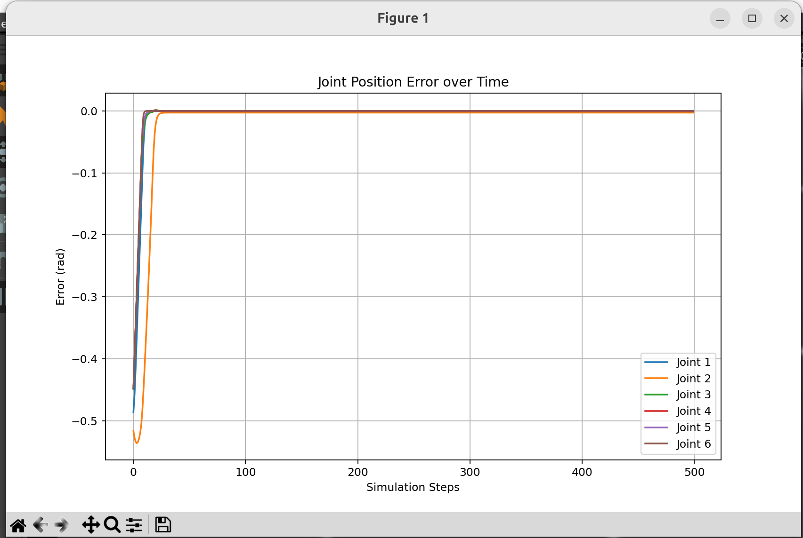
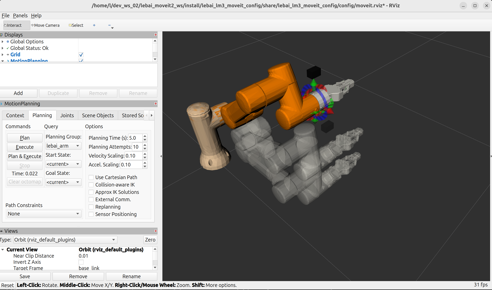

# Isaac Lab × Lebai LM3｜从仿真强化学习到实机与视觉模仿学习

围绕 **Lebai LM3 + LMG90 夹爪**开展的机器人学习实践：先学习 Isaac Lab 的任务框架与 PPO，再建立自己的机械臂仿真任务、尝试策略实机部署，最后通过专家示教数据训练 ACT，探索视觉条件下的抓取与放置和深入的任务。


## 项目导航

| 模块 | 主要内容 | 当前进展 |
| --- | --- | --- |
| [g1_learning](g1_learning/) | Isaac Lab 基础学习、场景搭建、Manager-Based / Direct 工作流、PPO 训练框架 | 完成基础示例与框架学习 |
| [my_robot_rl](my_robot_rl/) | Lebai LM3 + LMG90 建模、PD 动力学调试、IK、PPO Reach / Lift | Reach 完成，随机位置 Lift 实现稳定抓取与抬升 |
| [lebai_real_deploy](lebai_real_deploy/) | PPO 策略导出、观测与动作适配、Lebai SDK 实机控制 | 完成 Reach 实机初步验证，持续分析跟踪误差 |
| [Lebai-RoboACT](https://github.com/YQH-567/Lebai-RoboACT) | IK 专家数据采集、LeRobot 数据集、ACT 视觉模仿学习、SmolVLA 探索 | ACT 实现仿真 Lift / Place，持续进行视觉泛化实验 |
| [lebai_initial_moveit_config](https://github.com/YQH-567/lebai_initial_moveit_config) | ROS 2、MoveIt 2、Gazebo、运动规划、ArUco 视觉位姿估计 | 完成 MoveIt 规划验证与视觉节点开发，继续完善视觉引导抓取 |


**技术栈：** Python / PyTorch · Isaac Sim 5.1.0 · Isaac Lab 2.2.1 · skrl / PPO · URDF / USD · Differential IK · ROS 2 / MoveIt 2 · LeRobot / ACT

## 1. [g1_learning：Isaac Lab 基础学习](g1_learning/)

- 基础场景设置

    从官方示例入手，练习场景、资产、Articulation、Tensor 数据处理、Manager-Based / Direct 工作流，以及 skrl PPO 的训练与回放，为后续自定义 LM3 任务打基础。

- **快速开始：** 先配置可用的 Isaac Lab 环境，再按 [子目录 README](g1_learning/README.md) 运行对应示例。

## 2. [my_robot_rl：LM3 建模与 PPO Reach / Lift](my_robot_rl/)

- 物理建模

    将 LM3 与 LMG90 夹爪导入 Isaac Sim / Isaac Lab，检查 USD 关节、碰撞、惯量、Mimic 联动和 PD 驱动；使用 IK 验证运动与抓取可行性，并基于 skrl PPO 训练 Reach、Lift 任务。重要PD调节原理图：

    

- **目前效果：** 
    Reach 已完成仿真训练；**LiftNew 使用官方 Lift 奖励函数**，不额外引入抓取门控或触觉观测，在调整机械臂 PD 响应后，从零开始训练随机位置方块抓取，回放中抓取抬升接近全部成功。该成功率是当前实验观察，尚待统一口径的批量评估。过软 PD 也曾导致策略通过击打方块获得高度奖励，因此保留当前稳定的 PD 配置。

    

*LiftNew和reach 仿真回放截图；具体实验与训练记录见 [my_robot_rl/README.md](my_robot_rl/README.md)。*

- **快速开始**（已安装兼容版本的 Isaac Lab，并在仓库根目录执行）：

    ```bash
    pip install -e my_robot_rl/source/my_robot_rl

    # PPO Reach 训练
    python my_robot_rl/scripts/skrl/train.py --task Isaac-Reach-lebai_lm3-v0 --headless --num_envs 4096

    # PPO LiftNew：随机方块位置，从零训练
    python my_robot_rl/scripts/skrl/train.py --task Isaac-Lift-Cube-LebaiNew-v0 --headless --num_envs 4096

    # 使用已有 checkpoint 回放（替换实际权重路径）
    python my_robot_rl/scripts/skrl/play.py --task Isaac-Lift-Cube-LebaiNew-v0 --num_envs 16 --checkpoint /path/to/checkpoint.pt
    ```

模型、PD 调参如何调节参数、IK状态机怎么设置、训练问题和更多演示见 [my_robot_rl 详细记录](my_robot_rl/README.md)。

## 3. [lebai_real_deploy：PPO 实机验证](lebai_real_deploy/)

- 实机大致步骤

    将仿真训练的 Reach Actor 导出为 TorchScript，在独立 Python 环境中通过 **Lebai SDK** 实现关节状态读取、25 维观测构造、6 维动作映射、限幅与受限运行测试。

- **目前效果：** 已开展 LM3 实机 Reach 测试，发现关节跟踪与末端坐标对齐误差，仍在排查
    
    视频忘记拍了待补充

- **快速开始**（独立部署环境；先进行离线与只读测试）：

    ```bash
    cd lebai_real_deploy
    pip install -r requirements.txt      # PyTorch CPU 环境另行按子 README 配置
    python scripts/test_policy_offline.py

    # 连接真实机器人但不启用运动；需检查现场安全与网络条件
    python scripts/deploy_reach.py --ip <ROBOT_IP> --duration 2
    ```

部署环境、导出流程及安全约束见 [lebai_real_deploy/README.md](lebai_real_deploy/README.md)。

## 4. [Lebai-RoboACT：视觉模仿学习 Lift / Place](https://github.com/YQH-567/Lebai-RoboACT)

- ACT实现路径

    前面的 PPO 任务直接通过环境交互学习策略；在此基础上，我使用 **Isaac Lab + IK / 状态机**生成抓取与放置专家轨迹，采集外部与腕部相机 RGB、机器人状态和动作，整理为 **LeRobot 数据集**，训练 ACT 并进行仿真闭环评估。两条路线复用了同一类机械臂模型和仿真操作场景，分别探索强化学习与视觉模仿学习。

- **目前效果：** ACT 在包含物体位置信息的配置下，Lift / Place 回放表现接近全部成功；**不提供仿真物体坐标**、仅使用视觉及机器人自身状态的版本，初步测试成功率约 **70%–80%**。完整统计、视频及消融实验结果可以跳转查看

- **ACT 数据生成、训练、评估与视频直接查看：** 

    


## 5. [lebai_initial_moveit_config：ROS 2 / MoveIt 2 与视觉感知](https://github.com/YQH-567/lebai_initial_moveit_config)

- **主要内容：**

  基于 ROS 2 Jazzy、MoveIt 2 和 Gazebo Harmonic，搭建 Lebai LM3 + LMG90 机械臂工作区，完成 URDF/Xacro 建模、Mimic 夹爪联动、MoveIt 运动规划与碰撞检测，并集成腕部相机和 ArUco 6D 位姿估计，为后续视觉引导抓取和实机应用打基础。

- **目前效果：**

  已完成 ROS 2 功能包构建、MoveIt 机械臂运动规划与夹爪联动验证；实现真实 RGB 相机图像采集和 ArUco 位姿估计节点。Gazebo 完整运行、真实相机标定与视觉引导抓取仍待进一步验证。

  

- **快速启动：** 在完成依赖安装、工作区构建和环境加载后：

  ```bash
  # MoveIt 运动规划
  ros2 launch lebai_bringup bringup_lebai_lm3_with_gripper.launch.py

  # Gazebo 仿真
  ros2 launch lebai_bringup sim_lebai_lm3_with_gripper.launch.py
  ```

  详细配置、演示图片和实验记录见 [项目仓库](https://github.com/YQH-567/lebai_initial_moveit_config)。

---

> 项目仍在迭代；部分仿真资产、checkpoint 和实机设备依赖本地环境。训练效果与实机安全性需按各子项目说明独立验证。
