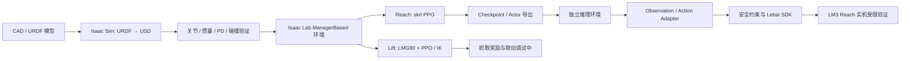

# Isaac Lab × Lebai LM3：从机器人 CAD/URDF 到 PPO 强化学习与实机部署

> **Robot Learning / Manipulation / Sim-to-Real** · Isaac Lab · Isaac Sim · skrl (PPO) · ROS 2 / MoveIt 2 · Lebai LM3
>
> 本仓库记录一个以 **Lebai LM3 六轴机械臂** 为核心的机器人学习实践：从机械模型整理与物理参数验证出发，在 Isaac Lab 中完成 Reach 任务训练，进一步扩展到带 LMG90 联动夹爪的 Lift 任务，并将 Reach Actor 导出到独立 Python 环境进行真实机械臂的受限测试。

[](https://github.com/isaac-sim/IsaacLab)
[](https://skrl.readthedocs.io/)
[](https://www.python.org/)
[](#3-实验进展与结果)

**仓库地址：** https://github.com/YQH-567/Isaaclab_RL_project

> [!IMPORTANT]
> **这是持续迭代的工程与学习记录，不是已完成完整量产级 Sim2Real 抓取的产品**
> - **Reach：** 已开展 Isaac Lab PPO 训练、策略导出和 LM3 实机受限验证；真实末端位置误差的几何定义仍须与机器人坐标系严格对齐。
> - **Lift：** 已实现仿真环境与夹爪模型，开展 PPO 训练和微分 IK / 状态机基线实验；联动夹爪的奖励设计、动作稳定性和可靠抓取仍在优化。
> - **实机 Lift：** 本仓库当前公开材料不提供可核验的完整成功率/实机抓取验证结果，因此**不宣称已实现稳定真机抓取**。
> - 训练权重、日志和硬件资产可能不随仓库完整分发；复现请先检查文件是否齐全。
> - 有问题可以联系我微信wxid_g6mc5bpls8gz22

## 目录

- [1. 项目概述与快速上手](#1-项目概述与快速上手)
  - [1.1 技术路线](#11-技术路线)
  - [1.2 仓库结构](#12-仓库结构)
  - [1.3 环境安装](#13-环境安装)
  - [1.4 快速训练与评估](#14-快速训练与评估)
- [2. g1_learning：Isaac Lab 基础与训练框架学习](#2-g1_learningisaac-lab-基础与训练框架学习)
- [3. 实验进展与结果](#3-实验进展与结果)
- [4. my_robot_rl：从机器人模型到 Reach/Lift](#4-my_robot_rl从机器人模型到-reachlift)
  - [4.1 建模与控制器检查](#41-建模与控制器检查)
  - [4.2 Reach：PPO 训练](#42-reachppo-训练)
  - [4.3 LMG90 夹爪与 Lift](#43-lmg90-夹爪与-lift)
  - [4.4 IK 状态机与对照基线](#44-ik-状态机与对照基线)
- [5. lebai_real_deploy：Reach 的 Sim2Real](#5-lebai_real_deployreach-的-sim2real)
  - [5.1 策略、观测与动作适配](#51-策略观测与动作适配)
  - [5.2 部署环境与验证顺序](#52-部署环境与验证顺序)
  - [5.3 实机安全说明](#53-实机安全说明)
- [6. 调试经验与常见问题](#6-调试经验与常见问题)
- [7. 复现边界、后续计划与参考资料](#7-复现边界后续计划与参考资料)

---

## 1. 项目概述与快速上手

### 1.1 技术路线

本项目的核心不是简单地运行一个 PPO 示例，而是回答三个相互连接的问题：

1. **机器人模型是否可信？** 从 CAD/URDF 到 USD 的几何、关节、质量、惯量和驱动配置是否正确？又怎么计算限制？
2. **学习任务定义是否合理？** 观测、动作、奖励、终止条件、物体状态和夹爪联动是否形成可以学习的 MDP？
3. **策略能否映射到真实机器人？** 训练时的关节顺序、默认姿态、动作缩放、坐标系和安全边界能否在真实 LM3 上一一对应？



**技术栈分工**

| 模块 | 技术 | 用途 |
| --- | --- | --- |
| 模型与资产 | SolidWorks、URDF、USD、Isaac Sim | 连杆、关节、惯量、碰撞、驱动与夹爪装配 |
| 仿真训练 | Isaac Lab、Gymnasium、skrl、PyTorch | ManagerBased 环境、PPO 并行训练与策略评估 |
| 机器人控制 | PD、关节位置动作、Differential IK | 关节跟踪、可达性检查、抓取状态机基线 |
| 评估与可视化 | TensorBoard、`evaluate.py` | 训练曲线、距离阈值与持稳时间评估 |
| 实机部署 | TorchScript、NumPy、Lebai SDK | CPU 推理、观测/动作适配、关节控制和安全检查 |

### 1.2 仓库结构

下表列出**仓库根目录和关键入口**（不是对所有子目录的逐文件清单）：

```text
Isaaclab_RL_project/
├── README.md                       # 本文档：项目入口与复现指南
├── requirements.txt                # 训练端补充依赖；不包含 Isaac Lab / Isaac Sim 本体
├── g1_learning/
│   └── README.md                   # Isaac Lab 基础、Manager/Direct、PPO 学习记录
├── my_robot_rl/
│   ├── README.md                   # LM3 建模、PD、IK、Reach/Lift 的详细实验笔记
│   ├── assets/                     # 机器人/夹爪资产（以实际仓库内容为准）
│   ├── scripts/skrl/
│   │   ├── train.py                # PPO 训练入口
│   │   ├── play.py                 # checkpoint 回放
│   │   └── evaluate.py             # Reach 定量评估入口
│   └── source/my_robot_rl/
│       ├── setup.py                # 自定义任务 Python 包
│       └── my_robot_rl/
│           ├── assets/             # LM3 机器人配置
│           └── tasks/manager_based/
│               ├── reach/          # Reach 环境及奖励配置
│               └── lift/           # Lift 环境、夹爪、IK 状态机
├── lebai_real_deploy/
│   ├── README.md                   # 实机部署架构与原理
│   ├── requirements.txt            # 部署端的 NumPy/PyYAML/Lebai SDK 依赖
│   ├── scripts/
│   │   ├── deploy_reach.py         # Reach 实机受限验证
│   │   └── deploy_reach_v2.py      # 带进一步约束的试验脚本
│   └── ...                         # 配置、适配器、TorchScript 权重等
└── .gitignore
```

**深入阅读入口：**

- [Isaac Lab 基础学习笔记](g1_learning/README.md)：场景、资产、Tensor 形状、ManagerBased/Direct、PPO 训练调用链。
- [LM3 训练与建模笔记](my_robot_rl/README.md)：建模、动力学/PD、夹爪、Reach/Lift 和训练问题。
- [LM3 实机部署笔记](lebai_real_deploy/README.md)：策略导出、25 维观测、动作适配和实验安全。

> `g1_learning` 是早期工作目录名称，其中的重点是 **Isaac Lab 学习与教程实验**；不要将其误读为本仓库已完成 G1 人形机器人的整机 RL 训练或实机部署。

### 1.3 环境安装

#### 1.3.1 重要的版本约束

推荐 Linux（Ubuntu）+ NVIDIA GPU。**Isaac Lab、Isaac Sim、Python 和 CUDA/PyTorch 版本必须匹配。** 本仓库 `evaluate.py` 明确以 **Isaac Lab 2.x** 的 API 为基础；不能未经适配就假定最新的 Isaac Lab `main` / 3.x 可直接运行本项目。

请先按官方文档安装与你的代码匹配的 Isaac Sim / Isaac Lab：（我的isaaclab是2.2.1,isaacsim是5.1.0）

- [Isaac Lab 官方仓库](https://github.com/isaac-sim/IsaacLab)
- [Isaac Lab 官方安装指南](https://isaac-sim.github.io/IsaacLab/main/source/setup/installation/index.html)
- [Isaac Lab 官方版本兼容表](https://github.com/isaac-sim/IsaacLab#isaac-sim-compatibility)

**本仓库暂未在根目录锁定一套经第三方机器验证的精确 Isaac Sim / Isaac Lab / Python / PyTorch 版本组合。** 使用者应先安装官方兼容版本，再安装本项目的任务包；维护者应在本地确认后补齐版本记录。不要直接把当前版本的 `main` 当成既有 2.x 工程的兼容保证。

可以先记录已有训练环境的信息：

```bash
python --version
python -m pip show isaaclab isaaclab-rl isaacsim skrl torch  # 部分包名因安装方式而异
nvidia-smi
```

如果你使用的是 Isaac Lab 源码安装，先从相应版本的 `IsaacLab/` 目录按官方说明完成安装，再回到本仓库根目录。不要把整个 Isaac Lab 源码树作为本项目的 pip 依赖重复安装。

#### 1.3.2 克隆与安装自定义任务

```bash
git clone https://github.com/YQH-567/Isaaclab_RL_project.git
cd Isaaclab_RL_project

# 在已经可用的 Isaac Lab Python 环境中执行：
python -m pip install -r requirements.txt

# 验证 my_robot_rl 已安装，且可被 Python 找到
python -m pip show my_robot_rl
python -m pip check
```

根目录新增的 `requirements.txt` **只负责辅助工具与本地自定义包的可编辑安装**，不负责安装 Isaac Sim、Isaac Lab 或指定 CUDA 版本；它不能单独构建完整训练环境。其关键安装行为等价于：

```bash
python -m pip install -e my_robot_rl/source/my_robot_rl
```

**如果 SDK/仿真无法导入，请先核对安装环境和官方版本，再排查任务代码，而不是直接升级全部 pip 包。**

#### 1.3.3 训练端与部署端必须分开

训练时需要 Isaac Sim、Isaac Lab、skrl、GPU 支持和实验日志工具；`lebai_real_deploy/` 使用独立 CPU 推理环境，正常情况下不需要装 Isaac Sim / Isaac Lab。部署端单独安装方法见 [5.2](#52-部署环境与验证顺序)。

### 1.4 快速训练与评估

下面的命令应在**仓库根目录**执行，并假设已激活正确的 Isaac Lab 环境。`--task` 名称已按仓库的 Gym 注册代码核对；checkpoint 路径必须自行替换。

**① Reach：无界面训练**

```bash
python my_robot_rl/scripts/skrl/train.py \
  --task Isaac-Reach-lebai_lm3-v0 \
  --num_envs 4096 \
  --headless
```

**② 回放已训练的 Reach 策略**

```bash
python my_robot_rl/scripts/skrl/play.py \
  --task Isaac-Reach-lebai_lm3-v0 \
  --num_envs 16 \
  --checkpoint /path/to/your/agent_checkpoint.pt
```

**③ Reach 定量评估**

```bash
python my_robot_rl/scripts/skrl/evaluate.py \
  --task Isaac-Reach-lebai_lm3-v0 \
  --checkpoint /path/to/your/agent_checkpoint.pt \
  --num_trials 10 \
  --threshold 0.05 \
  --hold_time 0.2 \
  --headless
```

上面评估脚本的 `threshold` 是末端距离阈值（米），`hold_time` 是需要保持达标的时间（秒）；**参数值是复现实验的示例，不是本项目已经发布的成功率结论**。该脚本以单环境评估方式运行，具体输出格式和统计口径请以代码为准。

**④ Lift：继续训练/调试**

```bash
python my_robot_rl/scripts/skrl/train.py \
  --task Isaac-Lift-Cube-Lebai-v0 \
  --num_envs 4096 \
  --headless
```

> Lift 的训练过程仍在迭代，不能因为命令能启动就认定策略已学会可靠抓取。若要从 checkpoint 恢复/微调，需要同时确认旧 checkpoint 的观测维度、动作维度、网络结构和任务配置与当前版本一致，不能直接把 Reach 的 6 维动作策略当作 Lift 的 7 维策略继续加载。

**⑤ TensorBoard 训练记录**

```bash
# 将 /path/to/logs 替换为训练产生的实际日志目录
tensorboard --logdir /path/to/logs --port 6006
```

建议至少同时检查 `Total Reward`、各奖励项、`Episode Length`、策略熵/动作标准差以及独立评估结果；**奖励曲线上升不等于抓取成功率上升**。

---

## 2. g1_learning：Isaac Lab 基础与训练框架学习

[`g1_learning/README.md`](g1_learning/README.md) 是本项目的学习路径记录，主要涵盖：

| 阶段 | 主要内容 | 对后续项目的作用 |
| --- | --- | --- |
| 基础场景 | 空场景、原始体、RigidObject、DeformableObject | 理解资产配置、仿真步进和状态读写 |
| 关节与资产 | Articulation、InteractiveScene、SceneCfg | 为 LM3 建模和多环境管理打基础 |
| 任务设计 | Cartpole、ManagerBased / Direct、MDP managers | 理解环境配置与实现的职责边界 |
| 强化学习 | skrl PPO、Agent YAML、训练/回放、TensorBoard | 理解 Actor/Critic、更新配置和结果诊断 |

这里最重要的工程认识是：**先明确 Tensor 的 shape，再理解数据是从仿真写入、缓冲区更新，还是只读 API 读取；其次区分任务配置与 PPO 超参数配置。**

```text
Gym Task 注册
    ↓
EnvCfg（Scene / Observation / Action / Reward / Termination / Event）
    ↓
ManagerBasedRLEnv / DirectRLEnv
    ↓
skrl PPO Agent 配置（网络、学习率、rollout、clip 等）
    ↓
train.py → rollout → PPO 更新 → checkpoint
    ↓
play.py / evaluate.py → 评估与复现
```

**推荐阅读顺序**：先看 `g1_learning/README.md` 对 Manager-Based 与 Direct 环境的讲解，再沿 `my_robot_rl` 的一次 `env.step(action)` 追到动作处理、物理步进、观测/奖励与策略更新；不要把 Isaac Lab 框架代码和自己的任务逻辑混为一谈。

---

## 3. 实验进展与结果

### 3.1 当前可核对的完成情况

| 任务/阶段 | 当前记录 | 验证边界 |
| --- | --- | --- |
| LM3 建模与驱动检查 | 已进行 URDF/USD 导入、关节检查、PD/力矩限制调试 | 模型配置需要与实际硬件参数继续核对 |
| Reach 仿真 PPO | 已建立自定义 Gym 任务及训练/回放/评估脚本 | 公开 README 尚无统一的成功率统计表 |
| Reach 实机 | 已编写并开展 SDK + TorchScript 的受限控制测试，研究关节跟踪误差 | `actual_flange_pose` 与训练坐标系尚未完全几何对齐；不能将诊断距离直接作为严格成功判据 |
| LMG90 Mimic 联动 | 已完成夹爪建模/装配、驱动轴调试与联动检查 | 联动关节的物理约束与动作惩罚仍需谨慎处理 |
| Lift / Pick-and-Place 仿真 | 已构建 Lift 任务并探索微分 IK 状态机与 PPO | 抓取稳定性、动作抖动和奖励设计仍在优化 |
| Lift 实机成功率 | **尚未提供可核验结果** | 不在此虚构成功次数、成功率或抓取视频 |

### 3.2 Benchmark / 演示材料如何复核

仓库当前公开的材料更适合称为**训练与工程验证记录**，而不是完整、可横向比较的标准化 Benchmark。（这里有空数据我会补上）：

| 指标 | 建议定义 | 当前公开数据 |
| --- | --- | --- |
| Reach 成功率 | 在固定阈值和持稳时间下 `success_trials / total_trials` | 待附 `evaluate.py` 的日志/CSV |
| Reach 末端误差 | 相同基座坐标系和末端参考点下的位姿差 | 待完成坐标系校准与统计 |
| 关节跟踪误差 | 各关节目标角与实测角的 MAE / RMSE / Max Error | 已有误差分析过程，待公开汇总表 |
| Lift 成功率 | 夹住并将物体抬过指定高度，持续指定时间 | 待稳定实验及测试记录 |
| Sim2Real 对比 | 相同任务、相近初始状态下仿真与真实结果对比 | 尚无完整对照数据 |

<!--
演示素材建议放在 docs/media/（不要放在已被 .gitignore 排除的 **/videos/ 下）。
实际提交素材后，可在此替换为真实的相对路径和说明，例如：


并补充实测日期、机器人配置、checkpoint、阈值与成功/失败次数。
不要把示意图当成结果图，也不要在未测量时填写成功率。
-->


---

## 4. my_robot_rl：从机器人模型到 Reach/Lift

本目录是项目的主要自定义训练工程。与直接复用官方 Franka 示例不同，LM3 的建模、默认关节姿态、末端参考点、夹爪结构和限制参数都需要重新检查或适配。

### 4.1 建模与控制器检查

**模型与物理配置流程**

1. 从 CAD/URDF 核对 `joint_1`～`joint_6` 的名称、父子连杆、旋转轴、限位、Visual/Collision Mesh 及惯性参数。
2. 使用 Isaac Sim URDF Importer 生成/检查 USD，确认 `Articulation Root`、关节自由度和根部固定方式。
3. 设置关节位置、速度、力矩等约束；检查质量、质心和惯量是否合理，避免模型在 Play 时出现非物理运动。
4. 设置驱动/PD 参数，在稳定姿态和多种测试动作下分别观察阶跃响应、正弦响应、超调、相位滞后与稳态误差。
5. 在 Isaac Lab 中定义 `ArticulationCfg`、默认关节姿态及环境资产引用，再进行多关节控制与 Reset 测试。

**来自内部实验笔记的两类典型问题**：

- **第 1 轴**：某组 PD 参数下出现欠阻尼振荡；需要根据响应曲线调整控制增益，而不是只看一次目标到达情况。
- **第 3 轴**：曾因力矩限制过小出现无法有效抬升/到达目标的情况；需要结合负载、重力项和可用驱动力矩核对参数。

需要注意：`τ = M(q)q̈ + C(q,q̇)q̇ + g(q) + τ_f + τ_ext` 是理解关节力矩组成的动力学形式；**模型估算值不等于厂商公布的真实持续/峰值电机额定值**。不能仅凭仿真调参结论推断实机扭矩能力。

详细控制测试、参数和分析见 [`my_robot_rl/README.md`](my_robot_rl/README.md)。

### 4.2 Reach：PPO 训练

**任务注册名**：`Isaac-Reach-lebai_lm3-v0`（保留源码中的大小写及下划线）。

主要配置入口：

- [Reach Gym 注册](my_robot_rl/source/my_robot_rl/my_robot_rl/tasks/manager_based/reach/config/lebai_lm3/__init__.py)
- [Reach 关节位置控制配置](my_robot_rl/source/my_robot_rl/my_robot_rl/tasks/manager_based/reach/config/lebai_lm3/joint_pos_env_cfg.py)
- [PPO 训练入口](my_robot_rl/scripts/skrl/train.py)
- [PPO 回放入口](my_robot_rl/scripts/skrl/play.py)
- [Reach 评估入口](my_robot_rl/scripts/skrl/evaluate.py)

Reach 在自定义配置中将机械臂更换为 `LEBAI_LM3_CFG`，以 `link_6` 作为末端跟踪参考连杆，并通过 `JointPositionActionCfg` 定义六轴关节位置动作：

```python
# 关键配置的示意摘录，真实值以 joint_pos_env_cfg.py 为准
JointPositionActionCfg(
    asset_name="robot",
    joint_names=["joint_.*"],
    scale=0.5,
    use_default_offset=True,
)
```

因此，**策略输出并不是可以直接发送给机器人的绝对关节角**。在本任务配置下，关节目标的基本转换形式为：

$$q_{\mathrm{target}} = q_{\mathrm{default}} + 0.5\,a$$

实际代码中还需要遵守关节顺序、动作裁剪、真实限位和发送频率。训练时通过末端位置/姿态跟踪奖励和动作变化、关节速度等惩罚共同约束行为；奖励权重应当结合评估与实际轨迹分析，不能仅凭 Total Reward 选取。

### 4.3 LMG90 夹爪与 Lift

**任务注册名**：`Isaac-Lift-Cube-Lebai-v0`。

主要配置入口：

- [Lift Gym 注册](my_robot_rl/source/my_robot_rl/my_robot_rl/tasks/manager_based/lift/config/lebai_lm3/__init__.py)
- [Lift 详细笔记](my_robot_rl/README.md)

**夹爪是本项目的重要技术难点。** LMG90 并非六个独立可控自由度的夹爪；其多个转动关节存在 Mimic 联动关系。内部笔记记录了 URDF 导入后需要人工复核的联动轴、关节限位、PD 和惯量配置。对于非独立驱动关节，尤其要防止错误的主动驱动设置与物理联动约束相互干扰。

内部笔记给出的夹爪幅度到关节角关系为：

$$\theta = \frac{\pi \cdot \mathrm{amplitude}}{300}$$

注意该关系依赖**当前夹爪模型与特定 SDK/控制定义**，实际方向和关节映射仍应以机械结构、URDF 和真实设备检查为准。

**Lift 的观测与动作不能照搬 Reach**。根据当前 Lift 记录：

| Observation 部分 | 维度 |
| --- | ---: |
| 机械臂及夹爪相对默认关节位置 | 12 |
| 机械臂及夹爪相对关节速度 | 12 |
| 物体相对于机器人基座的位置 | 3 |
| 目标末端位姿命令 | 7 |
| 上一步动作 | 7 |
| **合计** | **41** |

其动作是 **7 维**（机械臂 + 夹爪控制项），而非 Reach 的 6 维。需要以当前环境配置和 `env.action_manager` 实际输出为准检查维度。

**当前重点排查问题**：

- 策略可能在末端到达目标之前闭合夹爪，或到达后缺乏有效抓取动作。
- 接触阶段可能出现夹爪/机械臂抖动、动作速度过快，导致 Lift 奖励无法稳定改善。
- `joint_vel_l2`、`action_rate_l2` 等惩罚项的统计范围需要与实际受控关节一致；Mimic 联动关节不应该未经分析就和独立主动关节等价对待。
- 还需结合接触状态、物体抬升高度和独立成功判定区分“接近目标”和“真正抓取”。

这些属于**已观察到的工程问题和正在验证的改进方向**，这里不将其描述成已解决的稳定抓取成果。

### 4.4 IK 状态机与对照基线

在强化学习之外，仓库探索了 Differential IK 与 scripted manipulation state machine：

```text
目标末端位姿
    ↓
末端状态 / Jacobian / 当前关节角
    ↓
Differential IK 求解目标关节
    ↓
底层 PD / PhysX
    ↓
新的末端状态（闭环更新）
```

这一路线主要用于：

- 在 RL 之前检验机器人模型、末端 frame、目标可达性与接触场景是否合理。
- 为 Pick-and-Place 生成可解释的传统控制基线，辅助定位“本体问题还是奖励/探索问题”。
- 为后续模仿学习提供可能的专家轨迹生成方式，**但本仓库当前不把 VLA 微调作为已完成成果**。

实验笔记还记录了选错末端参考刚体导致目标姿态不可达，以及状态机切换时轨迹速度/加速度不连续等问题。后续可考虑轨迹插值、命令滤波、约束优化及真实执行器建模。

---

## 5. lebai_real_deploy：Reach 的 Sim2Real

### 5.1 策略、观测与动作适配

实机部署端使用独立 Python 环境；目标是从已训练 PPO 中导出 **Actor/TorchScript 推理模型**，不把完整 Isaac Sim、Critic、优化器和训练环境搬到控制机器上。

**训练环境中的 checkpoint 与部署端 TorchScript Actor 不是同一种文件格式**：前者可能包含 PPO Agent/优化器等训练状态，后者应能直接接收固定维度张量并输出动作。实机运行前须先完成导出和离线一致性验证。

Reach 的部署观测定义在当前部署实现中为 **25 维**：

| 数据项 | 维度 | 来源/注意事项 |
| --- | ---: | --- |
| 相对默认关节位置 | 6 | `q_real - q_default` |
| 关节速度 | 6 | SDK 状态，单位与顺序应一致 |
| 目标末端位姿 | 7 | 坐标系、四元数顺序必须与训练相同 |
| 上一时刻动作 | 6 | 与训练环境的 action history 定义一致 |
| **合计** | **25** | 推理时形状通常为 `(1, 25)` |

简化的数据流：

```text
Lebai SDK 实测状态 + 目标位姿 + 上一时刻动作
                     ↓
             Observation Adapter
                 (1, 25)
                     ↓
              TorchScript Actor
                 (1, 6)
                     ↓
           Action Adapter / scale
                     ↓
         关节限位与逐步增量安全约束
                     ↓
              Lebai SDK 下发
```

注意区分：

- **25 维 / 6 维**：本仓库 Reach 实机策略的 Observation / Action。
- **41 维 / 7 维**：当前带夹爪 Lift 仿真训练的 Observation / Action。
- 两者 **checkpoint 不可直接互换**。

### 5.2 部署环境与验证顺序

已存在的部署依赖文件：[`lebai_real_deploy/requirements.txt`](lebai_real_deploy/requirements.txt)，包含 `numpy`、`PyYAML`、`lebai-sdk`。PyTorch CPU 版本宜按官方渠道单独安装，避免在控制机器上意外安装大型 CUDA 组件。

**部署端示例（以 Ubuntu + Python 3.11 为例）：**

```bash
# 安装 conda 后：
conda create -n lm3_deploy python=3.11 -y
conda activate lm3_deploy

# Torch 的精确版本需与已经验证的导出/部署环境匹配：
# 示例沿用项目部署笔记中的 CPU 版本
python -m pip install torch==2.7.0 --index-url https://download.pytorch.org/whl/cpu

# 在仓库根目录执行
python -m pip install -r lebai_real_deploy/requirements.txt
python -m pip check
```

> 这是一份**部署端安装示例**，不是所有平台都已经测试通过的锁定版本。若 TorchScript 导出版本、操作系统或设备架构不同，需要重新做离线推理一致性检查。

**推荐验证顺序：**

1. 检查 `lebai_real_deploy/checkpoints/lm3_reach_policy.pt` 是否存在，确认它是 TorchScript Actor，不能把普通 PPO checkpoint 直接重命名过去。
2. 运行 [离线策略测试](lebai_real_deploy/scripts/test_policy_offline.py) 以验证加载、`(1, 25) → (1, 6)` 输出和有限数值。
3. 检查 SDK 安装与网络连通性，先读取机器人状态，不发送运动命令。
4. 确认关节顺序、初始姿态、机械限位、软限位、动作范围及现场急停。
5. 先执行**需要连接机器人但不下发运动的 read-only dry-run**；只有在现场安全审查后，才进行受限的真实动作测试。

```bash
cd lebai_real_deploy

# 完全离线策略检查（具体使用方式可先查看 --help / 脚本源码）
python scripts/test_policy_offline.py

# 注意：这不是纯离线；需要真实机器人可访问，但不启用实机运动
python scripts/deploy_reach.py --ip <ROBOT_IP> --duration 2
```

**真实动作试验**由 `--execute` 显式开启，且脚本实施受限时长、固定控制频率、关节起始姿态检查等限制。下列命令仅说明 CLI 接口，**不应在不了解设备状态或无人监护时执行**：

```bash
# 仅在已经完成风险评估、现场有操作员与急停保护时使用
python scripts/deploy_reach.py --ip <ROBOT_IP> --duration 2 --execute
```

本仓库的 `deploy_reach.py` / `deploy_reach_v2.py` 使用的是**受限实机试验控制**，不是经过安全认证的通用部署器；动作频率、限制阈值和可接受初始姿态应以对应脚本的当前实现为准。**目前不建议通过 README 示例改变这些限制或绕过确认。**

### 5.3 实机安全说明

- 实机执行必须由熟悉设备的人员在可控场地进行，确保工作空间无人员和障碍物侵入，并具有硬件急停。
- 软件限幅不能替代控制器本身的安全功能、碰撞防护或专业风险评估。
- 必须校验默认关节姿态、关节顺序、单位（rad/deg）、末端 frame 和目标坐标系。
- 观测或策略动作出现 `NaN/Inf`、连接超时、关节跟踪异常、测得速度异常等情况，应进入明确的停止流程。
- 目前代码提示真实 flange 与仿真 root/EE 的几何关系仍有待验证，因此**未经坐标系校准的 flange 诊断误差不能冒充真实 Reach 成功率**。
- 实机日志中不应公开设备认证凭据、内部网络配置或任何第三方私有资产。

---

## 6. 调试经验与常见问题

| 现象 | 首先检查什么 | 不应直接得出的结论 |
| --- | --- | --- |
| URDF/USD 导入后机器人掉落、抖动 | Articulation Root、质量/惯量、固定关节、关节轴和碰撞 | “强化学习训练不够” |
| PD 阶跃响应振荡 | Kp/Kd、求解器、控制步长、驱动模式 | “增加 PPO 惩罚就能解决” |
| 第 3 轴抬升困难 | 重力负载、力矩限制、姿态下的机械优势 | “所有关节力矩参数都相同即可” |
| Lift 抓取时关节异常 | Mimic 联动、非驱动关节约束、夹爪接触和惯性 | “六个夹爪关节都是独立动作” |
| Reward 上升但 Lift 仍失败 | 逐项奖励、接触状态、抬升高度、Success 条件 | “总奖励增加等于任务完成” |
| 仿真动作正常、真机偏差大 | Joint order、default q、action scale、坐标系、PD/限位 | “checkpoint 损坏” |
| 训练和部署 Actor 输出不一致 | 观测顺序、归一化、dtype、模型导出流程 | “仅是硬件噪声” |
| `--task` 找不到环境 | 是否 `pip install -e`、Gym 是否注册、`import my_robot_rl.tasks` | “Isaac Lab 本身没有这个任务” |
| TensorBoard 不显示曲线 | `--logdir` 是否指向实际 events 文件目录 | “训练没有进行” |

**更详细的排查过程**：

- [`g1_learning/README.md`](g1_learning/README.md)：Tensor 结构、ManagerBased/Direct 和 PPO 训练曲线诊断。
- [`my_robot_rl/README.md`](my_robot_rl/README.md)：PD、力矩限制、夹爪 mimic、IK、Lift 奖励。
- [`lebai_real_deploy/README.md`](lebai_real_deploy/README.md)：checkpoint 导出、动作适配及实机验证边界。

---

## 7. 复现边界、后续计划与参考资料

### 7.1 已知复现边界

1. **未发布完整依赖锁文件**：项目仍需按实际 Isaac Lab 2.x / Isaac Sim 兼容关系配置。根目录 `requirements.txt` 只是辅助安装，不是 `pip freeze` 复现环境。
2. **外部资产可能缺失**：部分 USD、mesh、训练 checkpoint 或日志可能因体积、版权或 `.gitignore` 规则未提交。请检查资产路径，避免将源码中的 `/home/...` 绝对路径原样复制到其他机器。
3. **训练结果需提供实验证据**：若公开模型或视频，建议同步提供对应 commit、checkpoint、评估设置、seed、次数和失败案例。
4. **真机验证条件依赖设备**：网络/SDK、工作空间、关节零位、夹爪模型和安全设置都必须重新核对；公开代码不意味着在任何 LM3 上可直接安全运行。
5. **第三方项目许可**：仓库借鉴了 Isaac Lab 示例及其他依赖，发布/再分发模型和脚本时应遵守各上游许可。本仓库根目录尚需明确自己的 `LICENSE`，不能仅从依赖源码的头部许可推断整个仓库都采用同一许可证。

### 7.2 后续工作

- [ ] 将已经完成的 Reach 实机试验整理成**可复核的定量表格、曲线和视频**（含坐标系校准说明）。
- [ ] 完善 Lift 奖励函数、夹爪接触与 Mimic 关节的正则项统计范围，并统计独立成功率。
- [ ] 记录并固定一套已验证的训练环境版本，提供明确硬件配置、配置文件快照、随机种子。
- [ ] 为模型和部署端补充无硬件的单元测试，以及观测/动作一致性回归测试。
- [ ] 在结果稳定后再考虑域随机化、仿真到实机的系统比较，以及更复杂的操作策略。

### 7.3 参考资料

- [NVIDIA Isaac Lab](https://github.com/isaac-sim/IsaacLab) / [官方文档](https://isaac-sim.github.io/IsaacLab/)
- [Isaac Sim](https://developer.nvidia.com/isaac/sim)
- [skrl：强化学习框架](https://skrl.readthedocs.io/)
- [PyTorch](https://pytorch.org/)
- [ROS 2](https://docs.ros.org/) / [MoveIt 2](https://moveit.picknik.ai/)

---

