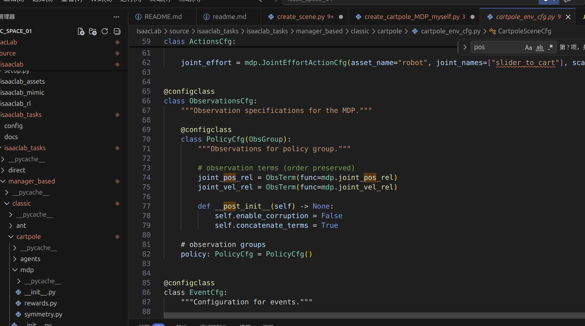
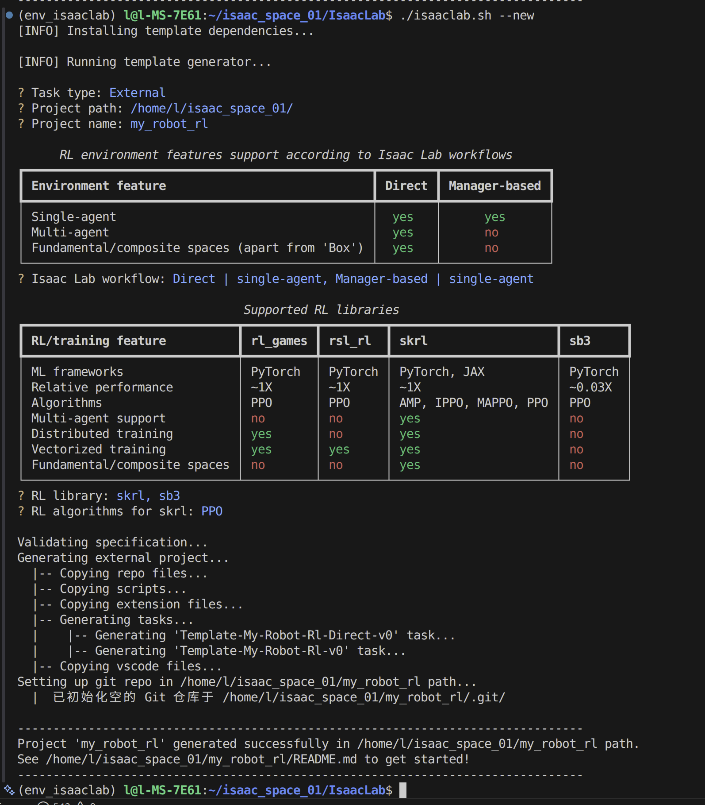
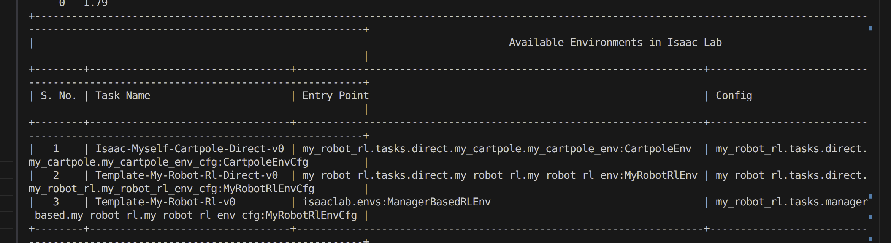
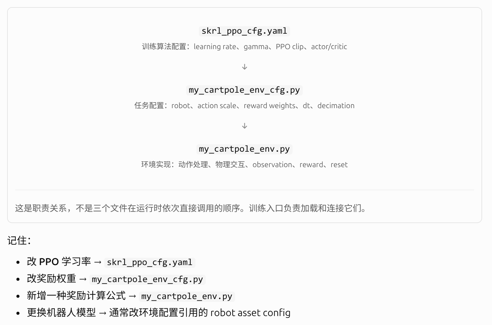

# 跟着官方案例学习isaaclab的流程

## 1. 概念集合

## 2. isaaclab场景建模案例讲解
### 2.1 生成一个空世界
        `/home/l/isaac_space_01/g1_learning/learning_src/create_empty_myself.py`
        这里的内容都在这个py文件里了，我的中文注释

### 2.2 生成原始体
        `/home/l/isaac_space_01/g1_learning/learning_src/spawn_prims_myself.py`
        这里只是生成场景，没有run_simulation的环节

### 2.3 刚体循环
        `/home/l/isaac_space_01/g1_learning/learning_src/run_rigid_object_myself.py`
        这是一个蓝色正方体的落地循环，当然可以看官方案例run_rigid_object.py文件，2.2和2.3暴露的问题是对isaaclab写配置到生成资产到仿真运动的理解问题，已经一些数据结构的问题
        
        ```
        状态数据结构：
        root_state是一整套状态，reset必须 `位置恢复+速度恢复`
        13维
        [position(3), quaternion(4), linear_velocity(3), angular_velocity(3)]
        13维
            │
            ├── :7
            │    └── pose
            │        ├── position
            │        └── rotation
            │
            └── 7:
                └── velocity
                    ├── linear velocity
                    └── angular velocity
        ```

        ```
        配置到仿真过程：

        ```

### 2.4 可变形体循环
        `/home/l/isaac_space_01/g1_learning/learning_src/run_deformable_object_myself.py`
        
        这是四个可变形体的状态，两个挂墙上被自然重力变形垂落，另外两个则是落地之后在Q弹几下

        ```
        1. 官方 API 对 transform_nodal_pos() 的描述也是：对 nodal positions 施加 pose transformation。
        2. 这里核心的注意点是和刚体的13维是不一样的，变形体是6维，且有一些柏松比等的一些材料性质，以后这里的数据结构问题非常重要
        假设
        nodal_state.shape
        =
        (4, 100, 6)

        4   → 4个 Cube
        100 → 每个 Cube 100个 simulation nodes
        6   → xyz + vx vy vz
        那么nodal_state[..., :3]等价于nodal_state[:, :, :3]，即
        所有 
                Cube
                ↓
                所有 node
                ↓
                只取前三列 xyz
        3. 另外一个和可变形体的区别
        刚体：

        一个 root pose
        控制整个刚体

        可变形体：

        没有真正意义上的 root orientation

        所有 nodes
        共同定义整个物体的状态
        4. 对于nodal_kinematic_target[[0, 3], 0, 2] += 0.001的理解
        完整拆解应该是：
                nodal_kinematic_target[
                [0, 3],   # 第0号、第3号 Cube
                0,        # 每个 Cube 的第0号 node   （这里是你之前不太理解的内容，对于deformable的）
                2         # target position 的 z
                ]
        ```

        2.1-2.4总结：
                1. Tensor shape + indexing。看到任何 Tensor 都先问 shape 是什么，例如 nodal_state: (4,N,6)、kinematic_target: (4,N,4)、root_pos_w: (4,3)。把 :, :3, 3:, ..., [0,3] 真正掌握。
                2. RigidObject 和 DeformableObject 的状态表示区别。Rigid 是 root 13维状态；Deformable 是每个 node 的 [pos, vel]，不要再把两套状态混起来。
                3. data / buffer / PhysX 三者关系。cube_object.data.xxx 是 Isaac Lab 给你的数据接口；write_xxx_to_sim() 是往 PhysX 写；update(dt) 是让 Asset 的数据侧跟上新的 simulation time。
                4. 标准仿真循环顺序。先写命令，再 sim.step()，再 asset.update(dt)，最后读取状态。这个顺序以后机械臂控制和 RL 里还会不断出现。
                5. 坐标系后缀。你这里频繁出现 _w，就是 world frame。以后还会看到 body/local/env frame。看到变量名不要只看前半截，Isaac Lab 的后缀经常决定变量真正含义。
                6. 多实例并行思想。prim_path="/World/Origin.*/Cube" 一口气匹配四个物体；num_instances=4；后面所有 Tensor 第一维都是 instance。这其实已经是在给你铺垫以后 1024/4096 个 RL 并行环境。
   
### 2.5 关节控制循环
        `/home/l/isaac_space_01/g1_learning/learning_src/create_scene_cartpole_myself.py`
        这是一个滑动关节和转动关节的机构的运动，对于理解关节运动和关节设置非常重要
        核心：Articulation 是一个由多个 rigid body 通过 joint 连接形成的整体动力学系统。代码里面有很详细的学习注释

        1. @configclass里面的意思
        {ENV_REGEX_NS}是 Isaac Lab 的特殊占位符，它最后会变成
        ```
        /World/envs/env_0/Robot

        /World/envs/env_1/Robot
        ```
        2. 并且要理解的核心是：
        InteractiveSceneCfg 描述“场景里面有什么”，ArticulationCfg/RigidObjectCfg 描述“某个东西是什么”。这就是 Isaac Lab 的场景组织方式
                InteractiveSceneCfg
                        |
                        |
                        +-- ground: AssetBaseCfg
                        |
                        +-- light: AssetBaseCfg
                        |
                        +-- robot: ArticulationCfg
                        |
                        +-- object: RigidObjectCfg

### 2.6 cartpole的MDP强化学习过程
        1. 先从观察所有的关节的位置和速度开始，看这张图：
        
        `/home/l/isaac_space_01/IsaacLab/source/isaaclab_tasks/isaaclab_tasks/manager_based/classic/cartpole/cartpole_env_cfg.py`
        这里配置好关节那些之后，文件接下来是对事件的定义配置，接下来就是奖励定义（要先看是不是还是进程还在alive，欧式距离计算，速度过快惩罚等，记得给惩罚和奖励配权重），最后是终止定义，场景配置
        2. 完成cartpole_env_cfg.py的配置之后，完成小型执行脚本的定义，在此之前，需要理解command-manager和curriculum-mananger的区别，第一个命令管理器，可用于指定面向目标的行为，比如到达目标位置；第二个课程经理，逐渐增加任务的难度，训练期间从简单环境扩展到更复杂的环境
        3. 核心架构：管理器（Manager）模式：
                ManagerBasedEnv 是 Isaac Lab 中用于构建模块化、可配置仿真环境的核心基类，它通过“管理器”（Manager）模式将环境的各个功能解耦，特别适合传统机器人控制任务，是构建更复杂的强化学习环境 ManagerBasedRLEnv 的基础
                ManagerBasedEnv 的核心思想是分解与协调。它将环境的复杂功能拆分为多个独立的管理器，每个管理器负责一个特定方面，而 ManagerBasedEnv 则作为协调者，统一调用它们
        主要包含以下几个核心管理器：
            场景管理器 (Scene Manager)：负责创建和管理虚拟世界，包括机器人、物体、传感器等。

                观测管理器 (Observation Manager)：从仿真状态和传感器数据中生成观测值。

                动作管理器 (Action Manager)：将上层发送的原始动作转换为底层仿真指令。

                事件管理器 (Event Manager)：在特定事件（如重置、定时）触发时执行操作，例如复位场景或施加随机扰动。

                记录器管理器 (Recorder Manager)：负责记录仿真过程中的数据。

        这种模块化设计使得环境的不同部分（如观测、动作）可以独立替换和配置，便于协作开发和快速原型验证。
        4. 这个部分需要理解的核心框架是：
                CartpoleEnvCfg
                │
                ├── SceneCfg
                │   └── 世界里有什么
                │
                ├── ActionsCfg
                │   └── agent能控制什么
                │
                ├── ObservationsCfg
                │   └── agent能看到什么
                │
                ├── RewardsCfg
                │   └── 什么行为好
                │
                ├── TerminationsCfg
                │   └── episode什么时候结束
                │
                └── EventCfg
                └── reset/randomization等   
        而对于PPO算法，你的分层应该是这样，虽然这里还有没开启PPO，但我希望自己先有概念：
                PPO
                │
                ├── actor network
                ├── critic network
                ├── learning rate
                ├── clip range
                ├── gamma
                ├── lambda
                ├── batch size
                ├── epochs
                └── optimizer    
        Isaac Lab 官方就是故意把这两部分拆开的：task/env cfg 放在任务目录，而 PPO/RSL-RL/SB3 等 agent 配置放在 agents 相关配置中；不同 RL library 可以复用同一个环境，结合软件就是：
                        Isaac Lab Task
                                │
                        env_cfg.py
                                │
                ┌─────────────┼──────────────┐
                ↓             ↓              ↓
                observation reward         action
                │             │              │
                └─────────────┼──────────────┘
                                ↓
                        ManagerBasedRLEnv
                                │
                                │ Gym-like API
                                ↓
                        obs, reward, done, info
                                │
                                ↓
                        PPO / SAC / other
        5. 我觉得对于现在一下子接触很多的文件来看，建议以下的阅读学习顺序：
                沿着一次 env.step(action) 往下追。

                你以后固定按这一个顺序看代码：

                启动脚本：谁创建 env，谁调用 step()。
                env_cfg.py：这个任务有哪些 scene / action / observation / reward / termination。
                每个 func=mdp.xxx：真正的数据怎么算。
                ManagerBasedRLEnv.step()：action 如何被处理、physics 如何推进、reward/termination/obs 什么时候计算。
                agent cfg：PPO 的网络和超参数。
                train.py / PPO library：rollout、critic、loss、optimizer。
        6. ManagerBased 是“配置驱动的模块化环境”，Direct 是“自己写完整环境逻辑”
### 2.7 自己写一遍用skrl的train训练cartpole的PPO的环境
        1. 首先区分这三层的意思：
        | 层 | 文件 | 负责什么 |
        |---|---|---|
        | 环境 | `cartpole_env.py` | obs、action、reward、reset、physics |
        | 算法配置 | `agents/skrl_ppo_cfg.yaml` | PPO 网络、学习率、rollout、batch 等 |
        | 训练入口 | `scripts/reinforcement_learning/skrl/train.py` | 把环境和 skrl PPO 接起来开始训练 |

        对于一开始接触这样的结构来说，先不用对官方的agents，也就是算法，有任何的更改，先了解环境是如何构建和配置还有修改的，再去修改agents的配置查看效果了解这个算法的一些核心参数修改带来的结果，再了解一下这个环境怎么和这个yaml结合起来的，最后是这个yaml如何跟数理的PPO结合起来的 

        2. ./isaaclab.sh --new创建external的机器人任务，注册任务
        指令：
        `
        ./isaaclab.sh --new #选择你自己想放的目录，里面的选择见下图，核心是选direct和mananger还有算法
        python -m pip install -e source/my_robot_rl  #在/my_robot_rl下安装自己的包
        python scripts/list_envs.py   #查看任务，这里注意一开始注册会只显示Template的那两个任务，你需要在这个文件里面改if的显示条件
        `
        
        

        3. 分清楚env,env_cfg
        为什么要把 my_cartpole_env_cfg.py 和 my_cartpole_env.py 分开，这其实是一个很重要的软件设计思想：
        配置（Configuration）与实现（Implementation）分离。
        也算自己开发项目时去判断该改哪个文件的重要依据：

        

        4. 启动训练和评估的指令：
        ```
        python my_robot_rl/scripts/skrl/train.py --task=[自己的任务名称，在__init__里面定义的] --[还有一些其他参数你可以看着train.py里面自己定义]

        评估指令：
        python my_robot_rl/scripts/skrl/play.py --task=[自己的任务名称，在__init__里面定义的] --checkpoint=[自己训练出来的.pt文件路径] --[还有一些其他参数你可以看着play.py里面自己定义]

        ```

        5. 使用tensorboard查看Episode/Learning/Loss/Policy/Reward的曲线
        ```
        # 启动,目录别搞错，要在这个目录下看见events.out
        tensorboard --logdir=日志目录 --port=6006
        # 如果提示没有 tensorboard
        pip install tensorboard
        # 如果 6006 端口被占用
        tensorboard --logdir=日志目录 --port=6007
        ```
        另外如何大致评估tensorboard的曲线？：
        | 分组 | 优先看什么 | 主要判断 |
        |---|---|---|
        | Episode | `Total Reward、Episode Length` | 策略是否真的表现得更好 |
        | Learning | `Learning Rate、Entropy 等（如果记录了）` | 学习过程是否正常 |
        | Loss | `Policy Loss、Value Loss、Entropy Loss` | PPO 优化是否稳定 |       
        | Policy | `Action Std、Entropy、KL（如果有）` | 策略探索是否过强或过弱 |       
        | Reward | `各奖励项及 Total Reward` | 策略究竟靠什么获得奖励 |     
        具体曲线名称取决于你的 skrl 版本及 YAML 日志配置。如果某些指标没有记录，不需要强行寻找。

        快速诊断表格：
        | 观察到的现象 | 初步怀疑 | 下一步 |
        |---|---|---|
        | Reward 上升、Length 上升 | 正在学习 | 观察是否稳定，并运行评估 |
        | Reward 上升、Length 不变 | 奖励设计可能不合理 | 检查各奖励项、实际动作 |
        | Value Loss 剧烈增长 | Critic 拟合困难、尺度或更新问题 | 检查回报尺度、学习率、数据异常 |       
        | Entropy 很快下降，表现仍差 | 可能探索不足 | 检查动作标准差和熵相关参数 |       
        | KL 频繁过大 | 策略更新过激进 | 检查学习率、更新次数、裁剪设置 |
        | 曲线正常，但机器人动作异常 | 仿真或控制接口问题 | 检查 action scale、PD、joint target、reset | 

        6. 修改奖励函数，增加一个远离原点的惩罚
        对于cartpole这个案例增加的惩罚是
                \[
                r_{\text{cart-pos}}=-0.1x^2
                \]
        这里需要认真仔细查看每个参数的维度情况，不清楚的一定要严格自己运行查看一遍，可以用hasattr函数打印一次看情况,并且这段调试代码需要在定义 cart_pos 之后：
        `
                if not hasattr(self, "_debugged_reward"):
                print("joint_pos:", self.joint_pos.shape)
                print("cart_pos:", cart_pos.shape)
                self._debugged_reward = True
        `
        hasattr是python内置函数，全称是has attribute,意思是：判断某个对象有没有某个属性
        `hasattr(object, name)`
                object：要检查的对象

                name：属性名的字符串

                返回值：True 或 False

        7. 至此需要问自己完全理解调用链了吗？
        代码中也有很多的辅助理解
                CartpoleEnvCfg
                │
                ├── action_scale
                ├── rew_scale_cart_pos
                └── robot_cfg
                        │
                        ▼
                CartpoleEnv
                        │
                        ├── _setup_scene()
                        │      └── 创建 Articulation
                        │
                        ├── _pre_physics_step()
                        │      └── 接收并缩放动作
                        │
                        ├── _apply_action()
                        │      └── 写入关节力目标
                        │
                        ├── _get_observations()
                        │      └── 输出 (N, 4)
                        │
                        └── _get_rewards()
                                │
                                ├── 从 cfg 读取奖励权重
                                ├── 从 joint_pos 读取状态
                                │
                                ▼
                        compute_rewards()
                                │
                                └── 返回 (N,) 的 Reward
