## 3 LM3 机械臂 ManagerBased 强化学习项目
### 3.1 项目目标与系统结构
**1. 认清文件结构：**
```txt
保留现有的 .vscode、README.md、pyproject 等文件
my_robot_rl/
    assets/ 新增：机器人模型资产
        robots
            lm3/
                urdf/
                meshes/
                usd/
        grapper
            lmg90/

    scripts/
        tools/ 模型转换与检查
        tests/ 关节控制、复位测试
        skrl/ PPO 训练

    source/my_robot_rl/my_robot_rl/
        assets/ ArticulationCfg 配置代码
        tasks/ ManagerBased 环境
    docx/ 学习笔记、截图

    README.md
 ```
 **2. 模型本体urdf预览和isaaclab导入**
- meshes文件路径设置和插件预览：`package://robots/lm3/meshes/visual/base_link.stl`
安装好Vscode里的URDF-Preview可以进行机器人预览，查看关节转动范围/Visual/Collision/坐标系等等，如下图：

<p align="center">
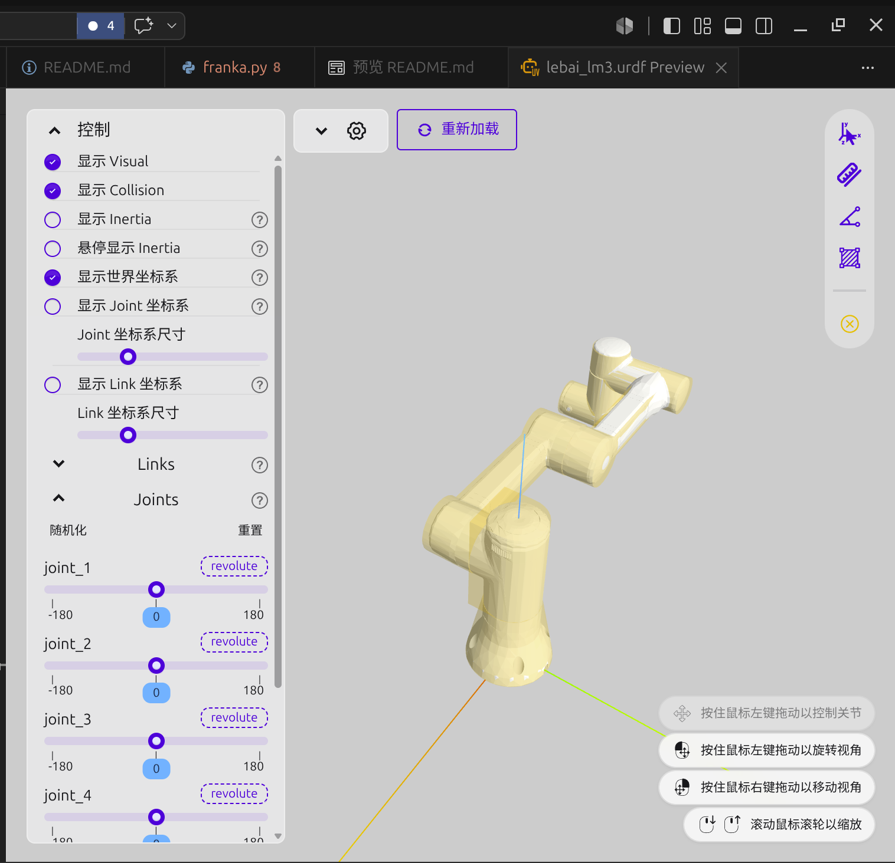
<br>
<sub>vscode插件预览URDF</sub>
</p>

- 插件使用和配置文件路径编写

在当前的工作空间的.vscode/settings.json里面说明路径
```json
{
    "python-envs.defaultEnvManager": "ms-python.python:conda",
    "python-envs.defaultPackageManager": "ms-python.python:conda",
    "ros.distro": "jazzy",
    "python.analysis.extraPaths": [
        "./IsaacLab/source/isaaclab",
        "./IsaacLab/source/isaaclab_assets"
    ],
    "urdf-visualizer.packages": {
        "robots": "/home/l/isaac_space_01/my_robot_rl/assets/robots",
        "grapper": "/home/l/isaac_space_01/my_robot_rl/assets/grapper",
    }//核心是这里的路径配置，不然点击URDF预览是看不到的，同时自己理解一下这里的配置原理
}
```

### 3.2 机器人 Asset 与物理模型验证
首先明白哪些配置应该在哪设置呢？：
| 参数类别 | 推荐存放位置 | 举例 |
|---|---|---|
| 机器人几何结构 | USD | Link、Visual Mesh、Collision Mesh |
| 关节物理结构 | USD | Joint Type、Axis、Body0/Body1、关节局部坐标系 |
| 质量与惯量 | USD | Mass、Center of Mass、Inertia |
| 机械关节限位 | 优先 USD | Lower/Upper Joint Limit |
| Articulation Root API | USD | 哪个节点是 Articulation Root |
| 基础物理求解参数 | USD 保存基准值，Python 可覆盖 | Solver Iterations、Sleep Threshold |
| 驱动与控制模型 | lm3.py | ImplicitActuatorCfg、PD 参数 |
| 初始关节姿态 | lm3.py | init_state.joint_pos |
| 任务中的机器人位置 | 环境 SceneCfg | prim_path、环境中的相对位置 |
| 强化学习动作空间 | 环境 ActionsCfg | JointPositionActionCfg |
| 奖励和终止条件 | 环境 RewardsCfg / TerminationsCfg | 距离奖励、成功判定 |
| 域随机化 | 环境 EventCfg | 质量、摩擦、初始状态随机化 |
#### 1. Articulation Root 检查
URDF从solidworks导出并且按照3.1放在对应的位置，（预览拓展能打开查看验证的话那路径什么的应该没有很大问题）,然后启动空模板`./isaaclab.sh -s`,然后左上角点击`importer`导入URDF文件，记得选固定,看图的选择：

<p>
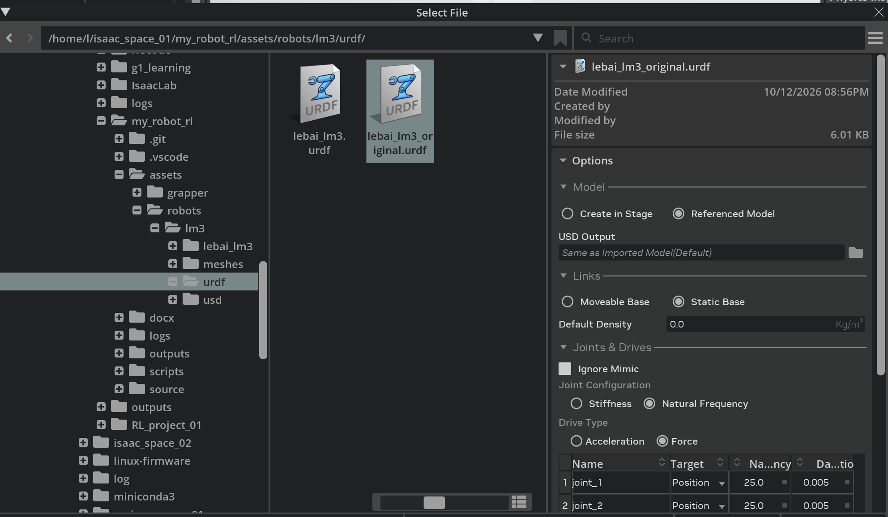
</p>

- ① 点击 Play
先让 PhysX 初始化机械臂物理系统。


- ② 打开 Physics Inspector
找到 LM3 对应的 Articulation 并刷新。


- ③ 检查六个自由度
应当能够看到 joint_1 到 joint_6 六个可动关节，并读取相应关节状态。
这里还需要注意的是。如果Physics Inspector没有刷新出来，看看你是不是有root_joint,root_joint有没有`Articulation Root`,如下图，特别注意右边的参数

<p>

</p>


#### 2. 六个关节参数调节及其依据

- 参数调节：

1. 理论依据:[自动控制原理调节依据](./docx/机器人关节PD控制器调参与验证.md)

2. isaaclab的增益调节器网址：https://docs.isaacsim.omniverse.nvidia.com/5.1.0/robot_setup/ext_isaacsim_robot_setup_gain_tuner.html

- isaac的增益调节器如何使用：

    在左侧 Gain Tuner 的 Test Gains Settings：
1. 将 Sinewave 切换为 Step Function。
2. 只勾选 joint_1 的 Test。
3. 设置 Step Minimum 和 Step Maximum。
4. 设置 Period、Test Duration。
5. 点击 RUN TEST。

- 以joint_1的阶跃响应的Kp和Kd的参数调节为例子：

    以下是不同Kd的阶跃响应为例子，数值为1-5，当Kd为1时，系统明显处于欠阻尼的状态，峰值大于目标值且收敛，对于欠阻尼来说，有超调量，响应时间，调节时间等的这些概念，特别对于阻尼选择这个东西，你可以大致有以下的概念：

    <span style="color:red; background:yellow;">
    阻尼比在 0.6～0.8 左右确实是经典二阶控制系统中经常采用的设计参考，它可以在响应速度和超调之间取得比较好的折中。
    但机器人关节控制器没有“ζ = 0.7 一定最优”这回事。

    例如：
    - 如果你需要快速响应，允许少量超调，可能选择较小阻尼。
    - 如果你需要精确抓取，必须尽量避免超调，可能更倾向于临界阻尼附近。
    - 如果存在严格的速度、力矩限制，单纯按照 ζ 设计也不够。
    - 如果机械臂存在复杂的关节耦合，单关节二阶模型只是近似。
    </span>

- 以下是isaaclab的调节图，分别是kd=1和kd=5的，2和3和4我就不放了，放在了docx里面：

    <p>
    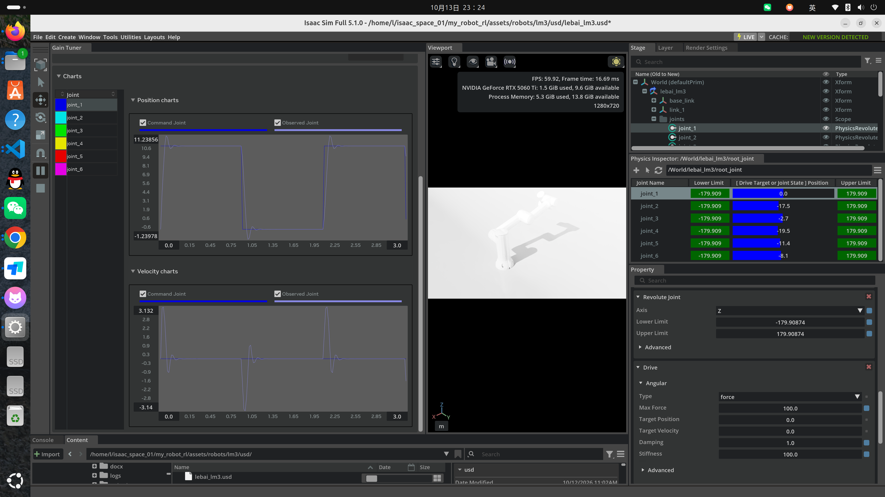
    </p>

    <p>
    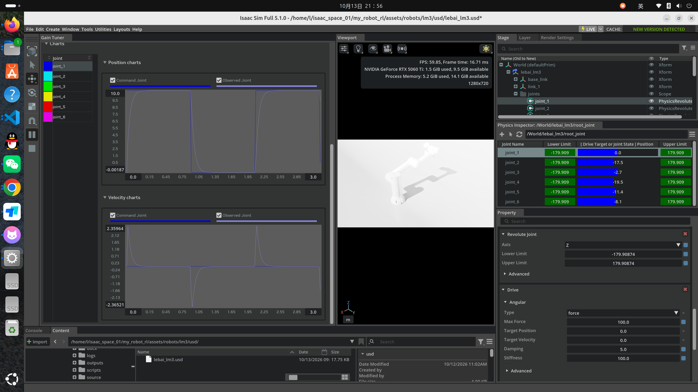
    </p>

- 正弦响应调节 

调节参数选择及其结果，比如joint_6，其他结果也差不多，2轴有点相位滞后，其他轴图片放docx里面：
    
    Amplitude=2%、Offset=0°、Period=4s、Duration=12s。
    观察 Command Joint 实际生成的角度范围，确认没有超出预期。
    对比 Observed Joint 是否跟上目标，记录相位滞后和幅值误差。
    低频跟踪稳定后，再尝试 Period=2s，保持其他参数不变。

<p>
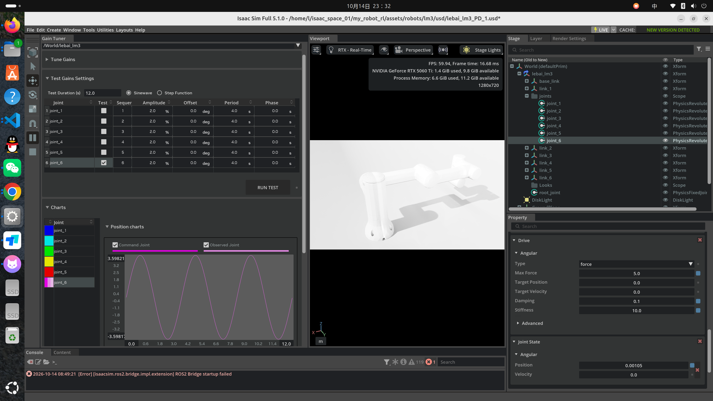
</p>

- 验证全部关节的流程：

    | 阶段 | 你需要完成的内容 |
    |---|---|
    | 1 | 六个关节分别完成小幅阶跃测试 |
    | 2 | 记录 Kp、Kd、超调量、调节时间和峰值速度 |
    | 3 | 每个关节选一组稳定且响应合理的参数 |
    | 4 | 验证两三个不同的机械臂安全姿态 |
    | 5 | 保存 USD 的基础 Drive 配置 |
    | 6 | 编写 lebai_lm3.py 和 Isaac Lab 控制测试 |
    | 7 | 完成多关节运动、Reset 和稳定性验证 |

或者换一种简单流程图：

            1. 静态检查
                |
                v
            2. 阶跃响应
                |
                v
            3. 正弦响应
                |
                v
            4. 多关节运动
                |
                v
            5. 不同负载

- 总结来说：

阶跃响应看什么？
1. 稳态误差
2. 超调
3. 调节时间
4. 振荡 (突然给目标，系统是否稳定)

正弦响应测试什么？
1. 相位滞后

    例如：
    目标：

    $$q_d=10\sin(t)$$

    实际：
    $$q=10\sin(t-30^\circ)$$
    说明：
    响应慢。

2. 幅值衰减

    目标：10°
    实际：8°
    说明：
    高频跟踪能力不足。

3. 高频稳定性

    机器人运动不是只有阶跃。
    RL里面：
    action不断变化：
    类似：
```python
0.1s:
目标1

0.2s:
目标2

0.3s:
目标3
```

所以动态跟踪能力重要。


### 3.3 cfg文件测试和articulation设置测试  

 1. 设置好PD之后在scripts/tests下写测试文件 三个实验
 实验代码： `/home/l/isaac_space_01/my_robot_rl/scripts/tests/test_lebai_lm3_control.py`
 增加你对怎么读取轴状态理解的代码： `/home/l/isaac_space_01/my_robot_rl/scripts/tests/test_lebai_lm3_articulation.py` 这也是后面这三个实验的重要基础，如果理解这个，这三个实验会做得很快
 -  实验一：保持 LM3 默认姿态 -> 打开就保持一开始的默认状态
 -  实验二： 只让关节 1 转动 1.57 rad，转个90度 -> 可以更改下标查看每个轴能不能转90度，同时理解怎么单独控制一个轴，500step之后重置的理解
 -  实验三：记录关节位置误差  -> 检验你的PD是否合理的重要步骤，也是检验自己模型有没有问题的一步 

 2. 实验3,记录误差以及分析误差原因，调整参数

 - 参考第一版的PD，得到的1轴和3轴的误差图，都不是渐渐逼近
    [PD第一版参数和第二版参数在文件下面](./docx/机器人关节PD控制器调参与验证.md)

    正常状态的误差图：
    <p>
    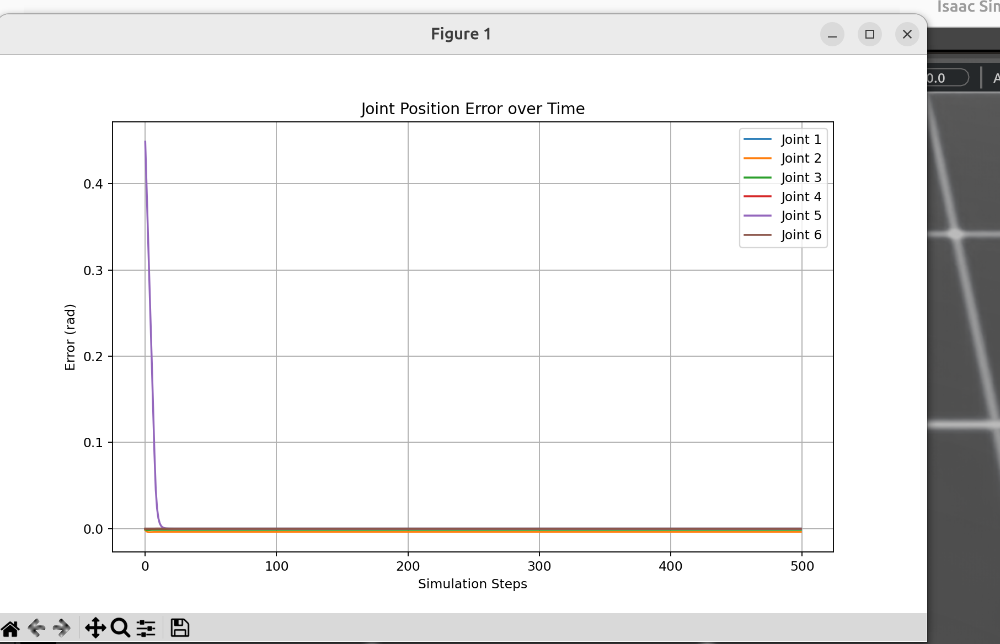
    </p>

    因为PD参数欠阻尼调节过于振荡，以至于1轴error图片如图：
    <p>
    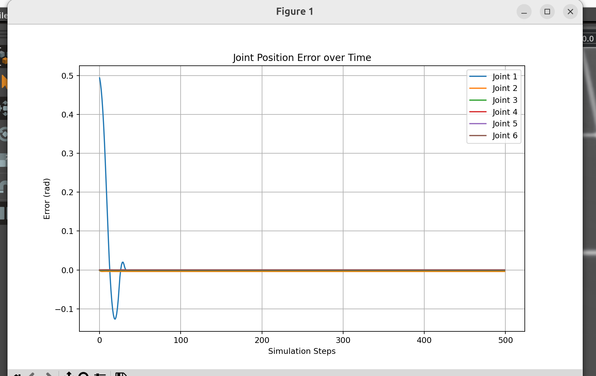
    </p>

    因为最大力矩限制太小导致无法到达目标点，甚至往上抬不起来后落地了都的3轴error图片：
    <p>
    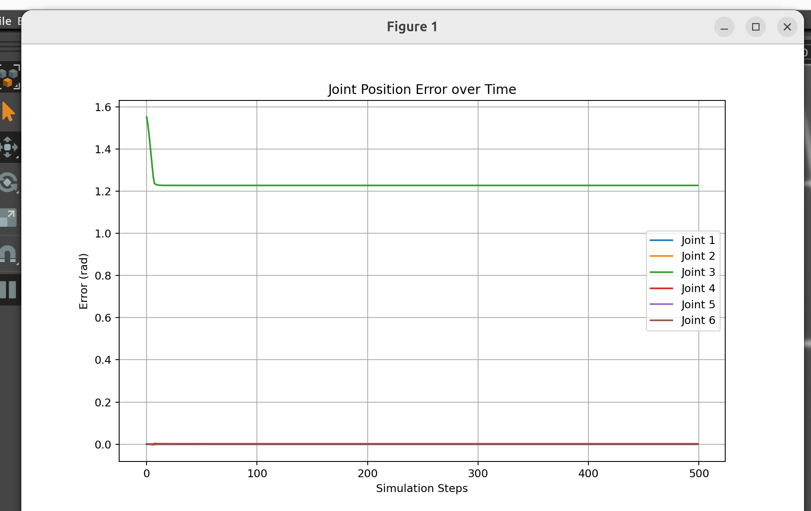
    </p>

    最终经过我的调整，然后全部轴一起运动后的误差图(2轴其实不是刚开始的最大受力状态的话，曲线会更好，比如从-40运动到-50)，所以说不是每个都能调得很好的曲线的，而且最终目的是RL训练，所以基本合格就可以：
    <p>
    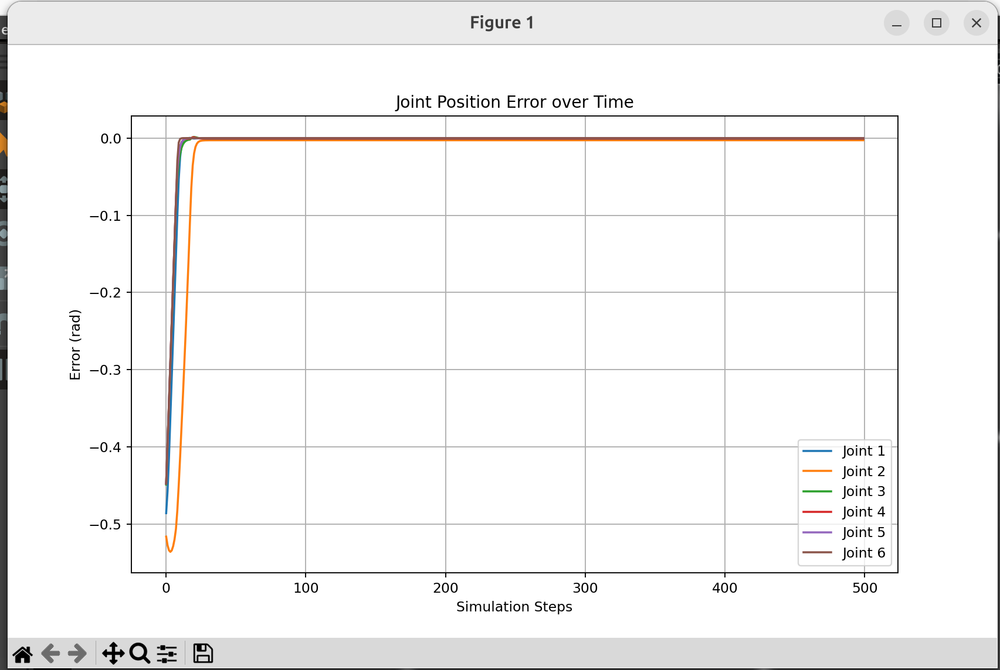
    </p>

<span style="color:red; background:yellow;">
对于为什么曲线有问题的分析，整个调整过程自己估计也会清楚，对于力矩限制这个问题，虽然说很大概率电机的供应商也会给出最大力矩限制，但是整个估算和设置过程，不仅可以解决选电机力矩的过程，也是推进对于机器人动力学建模的过程，动力学建模的公式已经我这里设置力矩限制的来源（乐白没给电机参数，官网ai出来的不可信）
</span>

#### 这个分析很重要！！，有空还是可以看看这个文档的 ####
    
[力矩限制怎么计算，电机怎么选力矩范围](./docx/LM3关节驱动力矩理论估算与URDF验证.md)

- 动力学重要公式,别忘力转动惯量啥啥啥的：

刚体机械臂动力学可写为：

$$
\boldsymbol\tau=M(\boldsymbol q)\ddot{\boldsymbol q}
+C(\boldsymbol q,\dot{\boldsymbol q})\dot{\boldsymbol q}
+\boldsymbol g(\boldsymbol q)+\boldsymbol\tau_f+\boldsymbol\tau_{\mathrm{ext}}
$$


### 3.4 PPO YAML 与环境的连接  ManagerBased 环境构建,暂时以reach实验为例子

1. 记得本身自己`./isaaclab.sh -n`时的选项，是有manager的

- 查看官方manager的经典案例，这里以Franka的Reach为例子，怎么写lebai 的reach

    步骤 (1)  
        把`/home/l/isaac_space_01/IsaacLab/source/isaaclab_tasks/isaaclab_tasks/manager_based/manipulation/reach`文件夹也复制到my_robot_rl对应的manager目录下，保留franka的就行，ur_10等其他的该删除就删除就好了，不用一下子看太多，同时也去看看官方的框架如何，方便以后任务的复用和结构设计

    步骤（2）
        更改注册文件，更改sb3_ppo_cfg.yaml和skrl_ppo_cfg.yaml里面的directory,不然找不到rollout在哪里：

```yaml
  experiment:
    directory: "reach_lebai_lm3"
    experiment_name: ""
    write_interval: auto
    checkpoint_interval: auto
```


2. 理解manager工作流修改乐白的`joint_pos_env_cfg.py`
- 具体改哪里
    其实就改`joint_pos_env_cfg.py`这个文件，其他manager都替你做好了，重点理解reward的权重怎么给出来的，欧式距离，tanh函数啥的，看我的代码详细注释：
    [joint_pos_env_cfg.py的reward和末端执行器设置](./source/my_robot_rl/my_robot_rl/tasks/manager_based/reach/config/lebai_lm3/joint_pos_env_cfg.py)

- manager帮你干的事情，也是不用怎么改的事情，当然要reach到的点的范围你需要根据机器人工作范围改

    [不用改的部分，基本reach任务都需要的](./source/my_robot_rl/my_robot_rl/tasks/manager_based/reach/reach_env_cfg.py)

- 一般可能出现的bug
    
    没有设置好机器人的初始位置，也就是`lebai_lm3.py`文件,自己去看看和官方对比
    
    传入参数到底是body还是joint


3. 官方`train.py`和`play.py`怎么使用以及设置能输出成功率的`evaluate.py`

```python
# 暂时没空写训练脚本，就这样先用着吧
python /home/l/isaac_space_01/my_robot_rl/scripts/skrl/train.py --task=   num_envs= (任务不复杂，我的16G5060TI可以跑8192绰绰有余)

python /home/l/isaac_space_01/my_robot_rl/scripts/skrl/play.py --task=  --checkpoint=  --num_envs=  

python /home/l/isaac_space_01/my_robot_rl/scripts/skrl/evaluate.py --task= --checkpoint= --num_envs=  
#这里注意看输出，会有成功率的统计，当然你需要看人家怎么设置的
```
<span style="color:red; background:yellow;">
    Gym 注册 → 环境配置 → skrl agent 配置 → train.py → rollout → PPO 更新 → checkpoint。
</span>

    
解释 Actor、Critic、GAE、clip 和学习率，结合 YAML 给出实际配置。

### 3.5 实验结果与诊断
    
    TensorBoard、末端到目标点距离、成功率、episode length、训练配置与 checkpoint 回放。

### 3.6 抓取与 Sim2Real 扩展,怎么生成笔记本部署需要的checkpoint,初始训练和实机部署的checkpoint的区别


    在 Reach 稳定以后加入抓取任务，再根据进度增加随机化与 Residual RL。

查看显卡状态：
`watch -n 1 nvidia-smi`

### 3.7 加爪实现流程

#### 1. 导入流程与3.1 差不多，因为mimic导致的坑如下：####

- 先是urdf速度设置全部为1不让其为0,然后导入后，`先不开启physics inspector` 
- 然后设置到`gripper_r_joint1`的PD参数不让它为0,同时设置`gripper_l_joint1`的mimic参考轴，因为导入进去就它参考轴是没有正确识别的，
- 还有`gripper_l_joint2`和`gripper_l_finger`和`gripper_l_joint1`的转动limited也没被正确识别出来需要设置好，这些都设置好检查之后再打开physics inspector查看是否有问题

    <span style="color:red; background:yellow;">
    中途没设置好就打开physics inspector都会出现上面的问题
    </span>

目前动力轴gripper_r_joint1的PD参数如下：

`stiffiness=2  damping=0.05`过阻尼，正弦和阶跃响应正常

- 还有一个很重要的设置是记得让不是驱动轴的`Natual Frequency = 0.0`,还有`Damping Ratio = 0`


最后的稳定版本usd:`/home/l/isaac_space_01/my_robot_rl/assets/grapper/lmg90/usd/lmg90_gripper_stable.usd`

#### 2. 补充lmg90的mimic对应关系：####

乐白官方 FAQ 直接给出了你现在仿真模型需要的关系：

$$\theta = \frac{\pi \cdot amplitude}{300}$$
然后六个关节满足：
$$
\begin{aligned}
q_{r1}&=\theta\\
q_{r2}&=-\theta\\
q_{rf}&=-\theta\\
q_{l1}&=\theta\\
q_{l2}&=-\theta\\
q_{lf}&=-\theta
\end{aligned}
$$
amplitude=100 对应主关节 π/3 rad = 60°

lmg90单独显示图：
<p>
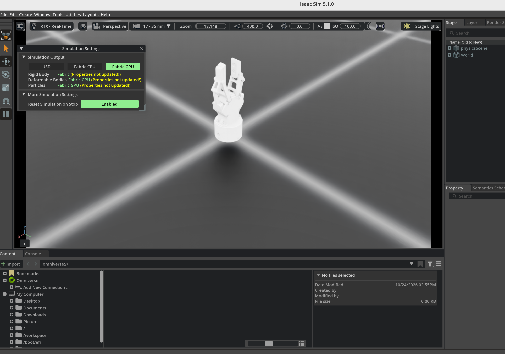
</p>

#### 3. 注意审查URDF有无漏洞（本次加爪本体制作时间长的具体原因）####

    <span style="color:red; background:yellow;">
    没检查URDF的惯性缺失！导致点开play夹爪四处乱跑！！
    </span>

```xml
    <inertial>
      <origin xyz="0 0 0" rpy="0 0 0"/>
      <mass value="0.30"/>
      <inertia
        ixx="0.001" ixy="0.0" ixz="0.0"
        iyy="0.001" iyz="0.0"
        izz="0.001"/>
    </inertial>
```
- 不过好在也解决了这个问题，驱动轴关节误差如下，没有什么大问题：

<p>
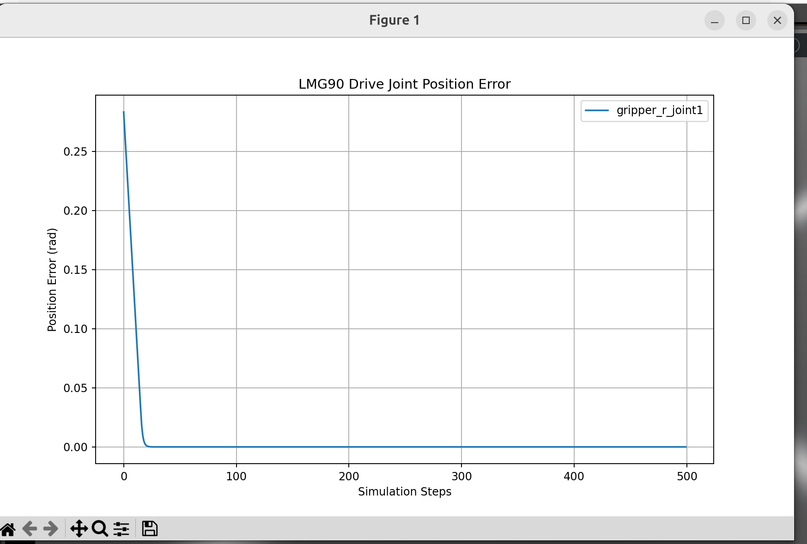
</p>

[测试的代码在这里:test_lmg90_gripper_articulation.py](./scripts/tests/test_lmg90_gripper_articulation.py)

### 3.8 机械臂和夹爪怎么结合起来确认没有问题

1. 另存之前的机械臂文件，然后把夹爪文件拖动进去
2. 使用robot Assembler把两者结合起来
3. 写测试文件测试机械臂的某个轴和夹爪的驱动轴，和之前差不多
[测试机械臂和夹爪结合有没有问题的测试文件](./scripts/tests/test_lebai_lmg90_gripper.py)

测试结果：这里测了3轴和夹爪驱动轴

<p>
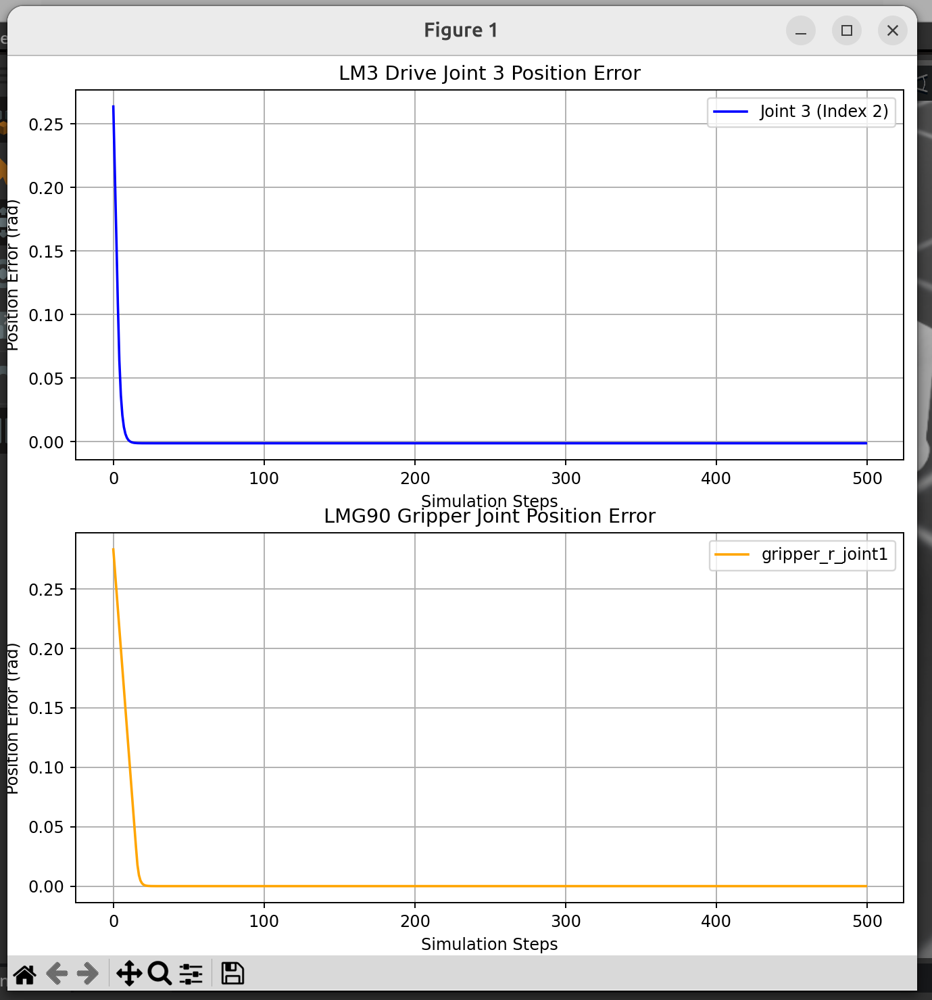
</p>


### 3.9 机械臂IK验证轨迹与模型
参考官网案例：https://isaac-sim.github.io/IsaacLab/main/source/how-to/run_diff_ik.html?

参考官方文件：`./isaaclab.sh -p scripts/tutorials/05_controllers/run_diff_ik.py`

自己写的微分IK文件：
[对齐位姿显示微分IK](./source/my_robot_rl/my_robot_rl/tasks/manager_based/lift/config/lebai_lm3/run_diff_if_without_RL.py)

1. Differential IK 控制链路。
$$ x_{goal}
\rightarrow
\texttt{set\_command}
\rightarrow
(x_{ee},J,q)
\rightarrow
\texttt{compute}
\rightarrow
q_{des}
\rightarrow
\text{PD}
\rightarrow
\text{PhysX}
\rightarrow
新的(x_{ee},J,q)$$

- 配置并创建 Differential IK controller。
- 明确“我要控制哪个末端 frame”，设置 task-space 目标。
- 每一步读取新的末端状态、Jacobian 和关节位置，重新 compute() 出新的关节目标，再交给关节 PD。
- reset 时同时 reset 机器人状态、controller 和 command。

#### 这几个去看我写在代码里面的详细注释 ####

2. pose / position。
3. absolute / relative command。
4. Jacobian 的作用与数据维度。
5. fixed-base 下 body_id - 1 的原因。
6. compute() 输入输出。
7. controller reset。

<span style="color:red; background:yellow;">
8. gripper_r_link_finger 作为 EE 导致姿态目标不可达的问题。

- 改为 gripper_base_link 后目标正常可达。

- PD 是底层 tracking 问题，不能解决 task-space 不可达问题。

</span>

#### 这里展示一下[x, y, z, qw, qx, qy, qz]对齐的效果会如何：####

<p>
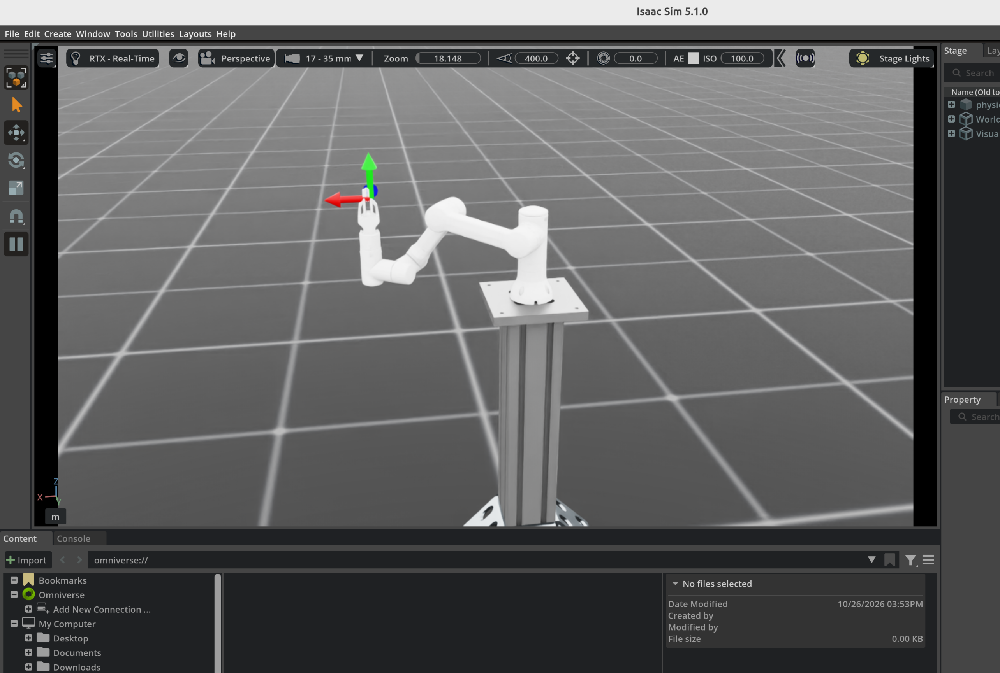
</p>

### 3.10 新的 manipulation state machine 的起点

#### 1. Lebai微分IK实现lift任务原因

- IK可以验证机械臂本体和环境设置是否出现问题
    
    如果本身本体和环境就有问题，RL是怎么也训练不出来的

- 模仿学习（Imitation Learning / Behavior Cloning）：

    把 IK 状态机跑成百上千遍，录下每一帧的 (观测, 动作)。直接让神经网络去监督学习（比如 MSE Loss），让它去“模仿” IK 的动作。这叫专家示范。

- 提供初始策略（Warm Start）：

    先用 IK 的数据预训练一下神经网络的权重，然后再扔进 RL 里微调。这样 RL 就跳过了一开始的“瞎猫碰死耗子”阶段，收敛极快。

- 课程学习（Curriculum Learning）：

    一开始把奖励函数设计成“靠近 IK 算出来的轨迹就加分”，等 RL 学会了，再慢慢撤回这个辅助，让它自己探索。

#### 2. 实现微分IK的lift的过程

    代码文件：
    [实现的主要代码](./source/my_robot_rl/my_robot_rl/tasks/manager_based/lift/config/lebai_lm3/scripted_lift_lm3_without_RL.py)

- 从main函数开始看，更改环境名字，并且查看环境配置的框架哪些地方需要更改
    
    [1]`my_robot_rl/source/my_robot_rl/my_robot_rl/tasks/manager_based/lift/config/lebai_lm3/__init__.py`: 这里注册gym

    [2]`my_robot_rl/source/my_robot_rl/my_robot_rl/tasks/manager_based/lift/config/lebai_lm3/ik_abs_env_cfg.py`  这里给机械臂写IK配置：`LebaiCubeLiftEnvCfg`,这里特别注意末端执行器的这个0.18的距离

    [3]`my_robot_rl/source/my_robot_rl/my_robot_rl/tasks/manager_based/lift/config/lebai_lm3/joint_pos_env_cfg.py`  这里是环境配置文件，同时RL也是通用的这个环境配置，包括小方块啥的: `LebaiCubeLiftEnvCfg`

    [4]`my_robot_rl/source/my_robot_rl/my_robot_rl/tasks/manager_based/lift/lift_env_cfg.py` 这里是lift环境的一些通用配置，目标位置,方块位置范围等等也在这，RL也需要，`LiftEnvCfg`,`CurriculumCfg`,`TerminationsCfg`,`RewardsCfg`,`EventCfg`,……`ObjectTableSceneCfg`

    [5] 写需要传入状态机数据创建状态机开始仿真

- 状态机内部设置
    
    状态机内部设置理解，这里代码注释很详细，仔细查看主要代码

#### 3. 最终实现效果：

<video src="./docx/IK_lift乐白效果.webm" controls width="600"></video>

#### 4. 怎么给状态机加状态

代码文件：
[给lift状态增加place放置和done的状态](./source/my_robot_rl/my_robot_rl/tasks/manager_based/lift/config/lebai_lm3/scripted_lift_and_place_lm3_without_RL.py)

- 核心增加： 放置点坐标：
```python
# 在__init__函数：

        # 🟢 在这里直接写入固定的放置点
        # 暂时让末端在 (0.3, 0, 0.3)，姿态保持默认(单位四元数)
        # Warp: (x, y, z, qx, qy, qz, qw)
        # 初始化放置位姿
        self.des_place_ee_pose = torch.zeros((self.num_envs, 7), device=self.device)
        self.des_place_ee_pose[:, 6] = 1.0  # 确保四元数合法 (w=1)   这里只初始化这个des_place_ee_pose，在下面计算那里再设置具体数值再传到warp

#在compute函数:

        object_quat = object_pose[:, 3:] 
        fixed_xyz = torch.tensor([0.3, -0.2, 0.1], device=self.device)
        self.des_place_ee_pose[:, 0:3] = fixed_xyz
        self.des_place_ee_pose[:, 3:] = object_quat

        ……
        # 4. 更新 warp
        self.des_place_ee_pose_wp = wp.from_torch(self.des_place_ee_pose.contiguous(), wp.transform)
```   
- 增加状态机elif 

    这里也看代码里面的详细注释

- 增加之后的效果 ：

<video src="./docx/IK_lift_place乐白效果.webm" controls width="600">
</video>

#### 5. 存在问题：

- 当前 scripted state machine 采用离散目标位姿切换，因此运动阶段存在一定的速度/加速度不连续。后续可通过 Cartesian trajectory interpolation / command filtering / actuator dynamic modeling 改进。该问题不影响当前 Pick-and-Place 可行性验证，因此留待 Sim2Real 阶段进一步处理

- `my_robot_rl/source/my_robot_rl/my_robot_rl/tasks/manager_based/lift/config/lebai_lm3/ik_rel_env_cfg.py`  这个文件暂时没理会，主要是相对运动的设置，也就是`use_relative_mode=True`,能用这个`scale=0.5`


### 3.11 lebai完整机械臂 lift的manager训练PPO

#### 1. observation观测值[num_envs,41]

$$ q_{\mathrm{rel}}=q_{\mathrm{current}}-q_{\mathrm{default}} $$

joint_vel_rel 则是相对于默认关节速度的偏移量,relative是相对的意思

这里41维度的定义分别是`joint_pos_rel`,`joint_vel_rel`,`object_position_in_robot_root_frame`,`generated_commands`,`last_action`,详细定义代码看代码跳转

| 维度 | 实际含义 |
|---|---|
| 0–11 | 机械臂及夹爪相对默认位置的关节位置 |
| 12–23 | 机械臂及夹爪相对默认速度的关节速度 |
| 24–26 | 方块相对于机器人基座的位置 |
| 27–33 | 指定机器人刚体的目标位姿 |
| 34–40 | 最近一次输入 Action Manager 的动作 |

#### 2. 奖励函数设置问题
- 先使用官方案例的lift实现的效果和问题

- 新的奖励函数设置

- 中间遇到的问题和调式方法
- - 在到达目标点之前提前闭合
- - 到达之后不抓取
尝试微调已经能实现reach的pt文件：

```python
python scripts/skrl/train.py \
    --task Isaac-Lift-Cube-Lebai-v0 \
    --num_envs 4096 \
    --headless \
    --checkpoint /你的实际路径/checkpoints/agent_xxx.pt \
    --max_iterations 1000
```


#### 3. 怎么添加断点调式，特别是条件断点
举例获取状态机准备闭合夹爪的姿态是怎样的
设置条件断点：
在 actions = pick_sm.compute(...) 附近设置普通断点（F9）。
右键点击红色断点，选择 编辑断点（Edit Breakpoint）。
选择 表达式（Expression），即你截图里已经打开的输入框。
输入下面这个条件并按 Enter：
`env.unwrapped.episode_length_buf[0].item() == round(4.9 / env.unwrapped.step_dt)`

```python

robot = env.unwrapped.scene["robot"]

arm_ids, _ = robot.find_joints(
    [f"joint_{i}" for i in range(1, 7)],
    preserve_order=True,
)

q_pregrasp = robot.data.joint_pos[0, arm_ids].clone()
q_home = robot.data.default_joint_pos[0, arm_ids]

print("Pre-grasp:", q_pregrasp.tolist())
print("Home:", q_home.tolist())
print("Difference:", (q_pregrasp - q_home).tolist())
Pre-grasp: [2.835221290588379, -1.1763299703598022, 1.999188780784607, -2.389353036880493, -1.5708030462265015, -1.8771638870239258]
Home: [3.130000114440918, -1.9700000286102295, 1.7100000381469727, -1.2899999618530273, -1.6200000047683716, 0.0]
Difference: [-0.29477882385253906, 0.7936700582504272, 0.2891887426376343, -1.0993530750274658, 0.04919695854187012, -1.8771638870239258]
```


    当前 IK MD 收尾、commit。  ->ok
    看一遍官方 lift_cube_sm.py，重点理解 state transition，不要急着照抄。 ->ok
    新建 scripted_lift_lm3.py，自己实现 PRE_GRASP → APPROACH → CLOSE → LIFT。  ->ok
    固定 cube 成功率稳定后，加 TRANSPORT → PLACE → OPEN。  -> ok
    把它整理成 scripted_pick_place_lm3.py。  ->ok
    去读官方 manager_based/manipulation/lift，自己迁移 LM3 + LMG90 ->ok但效果不好
    跑 PPO Lift。  ->ok但效果不好
    随机化 cube 初始位置、质量、摩擦等。
    部署到你旁边那台真实 LM3。

            我建议按照以下顺序学习：
        内容	需要掌握的程度
        Actor / Critic	能解释各自的作用
        Rollout Buffer	明白采集了哪些数据
        Advantage / GAE	能解释为什么需要优势估计
        PPO Clipped Objective	能解释概率比和 clip 的作用
        Entropy	理解探索与利用
        Value Loss	理解 Critic 如何学习
        Mini-batch / Epoch	理解数据如何重复利用
        SKRL 配置	能够独立修改和判断参数影响