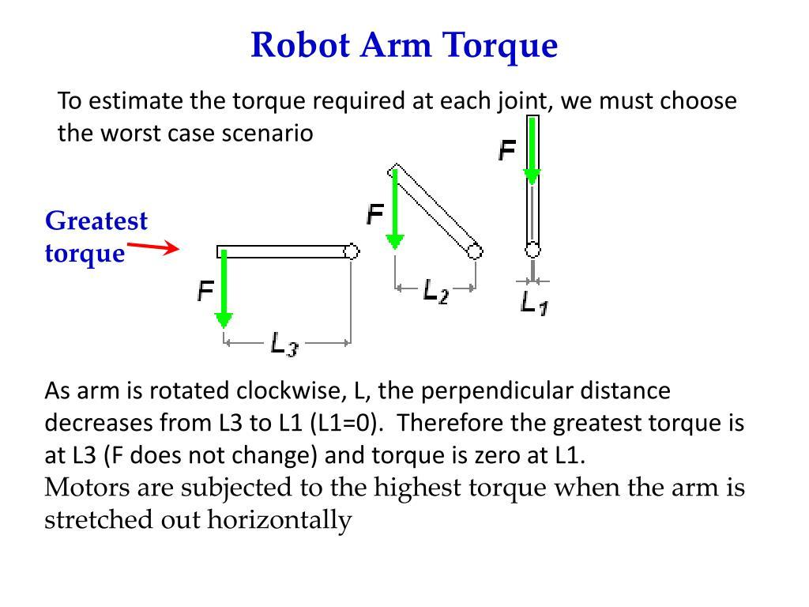
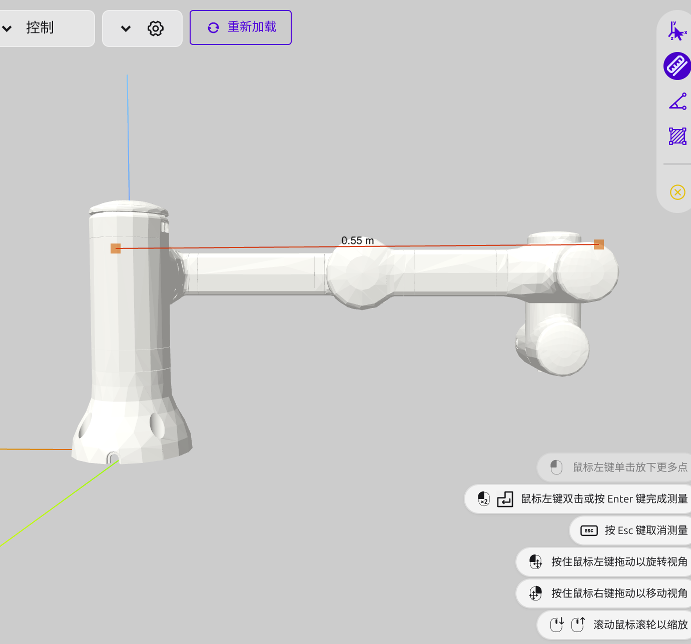

# 乐白 LM3 六自由度机械臂：关节驱动力矩的理论估算与 URDF 近似验证

> **用途**：Isaac Sim / Isaac Lab 中关节驱动力矩限幅的初步分析与调试记录。  
> **模型来源**：自主从 SolidWorks 导出 `lebai_lm3.urdf`，转换为 USD，并在 Isaac Lab 中通过 `ImplicitActuator` 控制。  
> **重要区别**：本文计算的是**特定模型和工况下的需求力矩**（估计值），**不是**乐白 LM3 真实电机的额定力矩、峰值力矩或经厂家认证的硬件限幅。不可直接用于实机安全设定。

## 1. 问题背景与建模边界

在 Isaac Lab 的关节位置跟踪实验中，若驱动力矩上限过低，第三轴运动时可能出现后续连杆下垂、末端触地和位置误差无法收敛的情况。因此，需要根据模型质量、质心、运动姿态以及假定的加速度需求，给出有依据的仿真限幅参考，而不能单靠反复增加 PD 增益。

计算分为两层：

1. **工程简化估算**：把下游连杆等效为均匀杆、末端负载视为集中质量，手算第 2 轴的重力与加速力矩。
2. **基于 URDF 的较精细计算**：使用各刚体的质量、质心、转动惯量以及六个关节的位姿关系，计算静态重力力矩和单关节加速惯量，并对多个姿态采样。

两种方法都不是对厂家电机极限的反求，也没有完整覆盖多关节同时高速运动、摩擦、接触、减速器、温升及驱动器保护等约束。

## 2. 第 2 轴：工程简化估算

### 2.1 假设

- 机械臂水平伸展；第 2 轴到假定末端负载位置的水平距离 $L=0.55\,\mathrm m$。
- 末端附加载荷 $m_p=3\,\mathrm{kg}$，集中在距离第 2 轴 $L$ 的点。
- 下游杆件合计 $m_l=7\,\mathrm{kg}$，粗略视为沿长度 $L$ 均匀分布。
- $g=10\,\mathrm{m/s^2}$，只为便于手算；较精细计算取 $9.81\,\mathrm{m/s^2}$。
- 假定 $\omega_{\max}=3.14\,\mathrm{rad/s}$，**另行假设** $\alpha=6.28\,\mathrm{rad/s^2}$。这是调试时选定的加速工况，而**不是**由最大速度必然推导出的加速度，也不是 LM3 官方加速度参数。
- 所有作用力矩方向取最不利的同向叠加；不考虑其他轴的耦合运动。

- 需要最大力的姿态演示：

- 机械臂图：

### 2.2 最大静态重力力矩的粗估

在水平伸展的简化模型中，负载作用线到关节轴的力臂最大。

末端负载：

$$
\tau_{g,p}=m_p gL=3\times 10\times0.55=16.50\ \mathrm{N\,m}
$$

均匀分布的杆件（等效质心在 $L/2$）：

$$
\tau_{g,l}=m_l g\frac{L}{2}=7\times10\times0.275=19.25\ \mathrm{N\,m}
$$

所以：

$$
\boxed{\tau_g\approx35.75\ \mathrm{N\,m}}
$$

### 2.3 加速力矩的粗估

注意：**集中在末端的 3 kg 不能使用均匀杆的 $\tfrac13mL^2$ 惯量公式**。在第二轴附近固定转轴的简化模型下：

$$
I\approx \underbrace{\frac13m_lL^2}_{\text{均匀杆}}+
\underbrace{m_pL^2}_{\text{末端集中质量}}
$$

$$
I\approx\frac13\times7\times0.55^2+3\times0.55^2
=1.6133\ \mathrm{kg\,m^2}
$$

$$
\tau_a=I\alpha\approx1.6133\times6.28=10.13\ \mathrm{N\,m}
$$

采用最不利同向叠加：

$$
\boxed{\tau_{\mathrm{req,2}}\approx\tau_g+\tau_a
=35.75+10.13=45.88\ \mathrm{N\,m}}
$$

**理解**：在上述*人为假定*工况下，第 2 轴需要约 $45.88\,\mathrm{N\,m}$；将仿真限幅暂时设为 $50\,\mathrm{N\,m}$ 可以作为诊断试验，但不足以证明真实 LM3 第 2 轴能持续输出 50 N·m。这里也没有留出合理的实机安全裕量。

## 3. 更精细的 URDF 模型计算

### 3.1 数据来源与关节链

数据直接来自当前 `lebai_lm3.urdf` 的 `<joint>` 和 `<link><inertial>`：

| 连杆 | 质量（kg） | 对应 URDF 关节链 |
|---|---:|---|
| link_1 | 2.147 | joint_1 → link_1 |
| link_2 | 1.972 | joint_2 → link_2 |
| link_3 | 1.668 | joint_3 → link_3 |
| link_4 | 0.969 | joint_4 → link_4 |
| link_5 | 0.969 | joint_5 → link_5 |
| link_6 | 0.584 | joint_6 → link_6 |
| **合计** | **8.309** | 不含 base_link、夹爪及新增负载 |

第 2 轴之后 `link_2` 至 `link_6` 的质量合计为 **6.162 kg**。当前 URDF 的 `base_link` 未包含惯性参数；本文不把其质量计入驱动关节下游负载。`tool0` 为无质量固定末端框架。

各连杆有独立的质心和惯量张量，例如：

- `link_2`：质心局部位置 $(-0.134,\ 0,\ 0.094)\,\mathrm m$；质量 1.972 kg。
- `link_3`：质心局部位置 $(-0.102,\ 0,\ 0.019)\,\mathrm m$；质量 1.668 kg。

这些**局部坐标不能直接相加**，必须由正向运动学转换到同一个世界坐标系。

### 3.2 静态重力矩：包含完整六轴姿态关系

对第 $j$ 个关节，先由 URDF 的关节原点、`rpy`、旋转轴和关节角 $\boldsymbol q$ 计算世界坐标下的关节轴单位向量 $\boldsymbol a_j$、关节轴上某点 $\boldsymbol p_j$，以及各下游连杆的质心位置 $\boldsymbol p_{c,i}$。

$$
\boxed{\tau_{g,j}(\boldsymbol q)=
\sum_{i\in\mathrm{desc}(j)}
\boldsymbol a_j^{\mathsf T}\left[
(\boldsymbol p_{c,i}-\boldsymbol p_j)\times m_i\boldsymbol g
\right]}
$$

其中 $\boldsymbol g=(0,0,-9.81)\,\mathrm{m/s^2}$。若末端安装假定负载，则在 `tool0` 位置增加一项 $m_p\boldsymbol g$。这里把 3 kg **作为 tool0 原点处的点质量**，没有考虑真实物品质心偏移和夹爪重量，因此该项是演示工况，并非真实抓取系统的完整负载。

### 3.3 单关节加速惯量：比均匀杆估算更精细

在其余关节瞬时固定、仅关节 $j$ 加速的假设下，下游系统绕第 $j$ 轴的等效转动惯量：

$$
I_{jj}(\boldsymbol q)=\sum_{i\in\mathrm{desc}(j)}
\left[
\boldsymbol a_j^{\mathsf T}\boldsymbol R_i
\boldsymbol I_{c,i}\boldsymbol R_i^{\mathsf T}\boldsymbol a_j
+m_i\|\boldsymbol a_j\times(\boldsymbol p_{c,i}-\boldsymbol p_j)\|^2
\right]
$$

其中 $\boldsymbol I_{c,i}$ 是 URDF 惯量张量，$\boldsymbol R_i$ 是其世界姿态。该公式同时考虑各连杆绕自身质心的惯量与平行轴效应；末端点载荷只贡献平行轴项。

单轴初始加速需求近似：

$$
\tau_{\mathrm{test},j}(\boldsymbol q)
\approx \tau_{g,j}(\boldsymbol q)+I_{jj}(\boldsymbol q)\alpha_j
$$

为展示保守量级，下面列表采用 $\alpha_j=6.28\,\mathrm{rad/s^2}$，并列出 $\max|\tau_{g,j}|+6.28\max I_{jj}$。**两项极值可能发生在不同姿态，因此这一列是分项上界的组合指标，并非实际同时出现的力矩峰值。** 此式也未计入多关节耦合、科里奥利/离心项、摩擦和接触力矩。

### 3.4 六轴估计结果

**数值方法**：从 URDF 的运动链构造正向运动学，采用固定随机种子 `20261017`，在每轴区间约 $[-\pi,\pi]$ rad 内均匀抽取 **10,000 组姿态**，另加入全零姿态；以此得到采样范围内各轴的重力矩绝对值最大值和等效惯量最大值。未进行无碰撞路径或真实工作空间筛选，**不是严格数学全局最大值**；姿态采样越密、工况越明确，结果越可靠。

| 关节 | 无外载：最大采样静态重力矩 (N·m) | 无外载：重力＋单轴加速参考值 (N·m) | tool0 加 3 kg：最大采样静态重力矩 (N·m) | tool0 加 3 kg：重力＋单轴加速参考值 (N·m) |
|---|---:|---:|---:|---:|
| J1 | 0.00 | 7.80 | 0.00 | 16.31 |
| J2 | 23.17 | 30.68 | 42.65 | 58.44 |
| J3 | 9.13 | 10.87 | 20.41 | 24.95 |
| J4 | 1.03 | 1.11 | 4.67 | 5.07 |
| J5 | 0.09 | 0.11 | 2.55 | 2.69 |
| J6 | 0.00 | 0.003 | 0.00 | 0.003 |

> 注：保留到小数点后两位，J6 较小的加速参考值单独保留三位；这不是“无需第六轴驱动力”的意思，摩擦、夹爪偏心负载、接触及其他动态效应可能改变需求。第一轴旋转轴竖直，因此理想重力模型中静态重力矩为零，但旋转加速时仍需力矩。

**对比理解**：第 2 轴工程手算得到 35.75 N·m 静态、45.88 N·m（含假定加速）需求；基于 URDF 的采样结果在 3 kg 点载荷条件下是 42.65 N·m 静态和 58.44 N·m 的分项组合参考值。两者不相等，因为手算假设了 0.55 m 均匀杆和 7 kg 下游质量，而 URDF 使用真实关节链、分段质量和质心位置；后者的 58.44 N·m 又是不同姿态极值组合而非单一运动轨迹上的实际峰值。

### 3.5 与当前 Isaac Lab 力矩限幅对照

本次运行时输出的 `Effort limits`：

| 关节 | 当前 USD / Isaac Lab 力矩限幅 (N·m) | 无外载静态重力矩采样峰值 (N·m) | 解释 |
|---|---:|---:|---|
| J1 | 25 | 0.00 | 对竖直旋转轴，需关注惯性加速和摩擦等 |
| J2 | 25 | 23.17 | 某些姿态接近限幅；加入负载可能超过 |
| J3 | 15 | 9.13 | 无外载静态估计低于上限，但具体运动仍可饱和或触地 |
| J4 | 8 | 1.03 | 不代表加装工具及接触时仍充足 |
| J5 | 8 | 0.09 | 不代表实际硬件额定力矩 |
| J6 | 5 | 0.00 | 真实末端工具偏心、摩擦与接触需要另计 |

**不要直接把 58.44 N·m 当作 J2 的真实 Max Force 推荐值**。如果只是仿真诊断，可以把限幅设为不同测试档位，并记录位置误差、力矩饱和和碰撞。若为真实 LM3 的仿真标定，应咨询厂家获取关节输出端的连续额定、瞬时峰值力矩与减速器限制，并校核完整工具/夹爪和质量惯量。

## 4. 为什么这仍不是完整的动力学建模？

刚体机械臂动力学可写为：

$$
\boldsymbol\tau=M(\boldsymbol q)\ddot{\boldsymbol q}
+C(\boldsymbol q,\dot{\boldsymbol q})\dot{\boldsymbol q}
+\boldsymbol g(\boldsymbol q)+\boldsymbol\tau_f+\boldsymbol\tau_{\mathrm{ext}}
$$

本文较精细计算只显式使用了重力项以及惯性矩阵的单轴对角项 $M_{jj}$，**没有**计算所有轴同时运动时的非对角惯性耦合、速度项、摩擦与外界接触力。关节速度上限 $3.14\,\mathrm{rad/s}$ 本身也不能决定加速度；加速度依赖于时间规划、可用驱动力矩、负载及控制器。

如需进一步验证，可以在具有相应依赖的环境中使用 **Pinocchio** 加载此 URDF，比较 `computeGeneralizedGravity(model, data, q)` 的重力项及 `crba(model, data, q)` 的惯性矩阵。需先确保关节顺序、坐标系、重力方向、夹爪与额外负载一致。当前文档的数值是基于 URDF 自行实现的运动学/惯性计算和随机采样，**不是 Pinocchio 实跑结果**。

## 5. 实验记录与后续计划

- **模型**：SolidWorks → URDF → USD → Isaac Lab；当前 PD 参数和 Max Force 已从运行时打印验证加载。
- **现象**：J3 在部分目标姿态下下游连杆下垂、末端触地；提高驱动力矩限幅后响应明显改善，表明限幅值得重点排查，但还应考虑 J2 共同支撑、碰撞及质量模型。
- **下一步**：仅对 J1–J3 做最后一轮关节阶跃验证；确保无持续振荡、碰撞和严重饱和；记录最终 USD 参数并冻结模型，随后推进 Isaac Lab PPO。
- **未来再做**：如进入 Sim2Real 阶段，补齐实际夹爪、负载的质量惯量，确认厂家真实力矩限幅，并通过 Pinocchio / 动力学库进行逆动力学与仿真对比。

### 参考与依据

1. `lebai_lm3.urdf`：本项目由 SolidWorks 导出的机器人结构与惯性参数（计算主要数据源）。
2. `lebai_lm3.py`：Isaac Lab `ArticulationCfg` / `ImplicitActuatorCfg`，执行器 PD 与限幅从 USD 继承。
3. Isaac Lab 运行时输出：`joint_stiffness`、`joint_damping`、`joint_effort_limits`、`joint_vel_limits`、`joint_pos_limits`。
4. 乐白机器人产品手册：https://help.lebai.ltd/guide/product.html （用于对照官方公布的整机产品参数，**未据此确认逐轴额定/峰值力矩**）。
5. Pinocchio 官方文档：https://stack-of-tasks.github.io/pinocchio/ （后续独立核对动力学计算的工具参考）。
